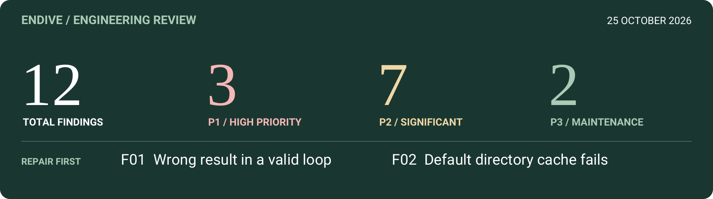
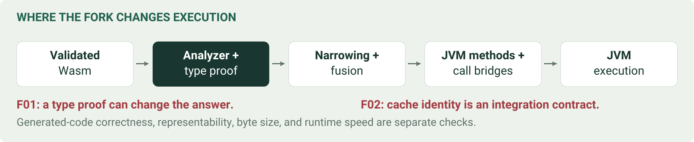
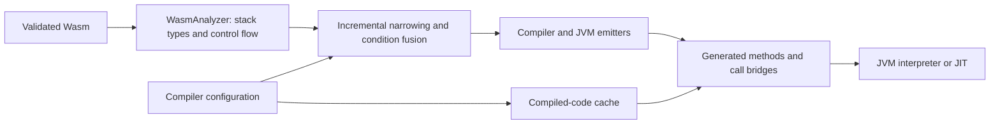
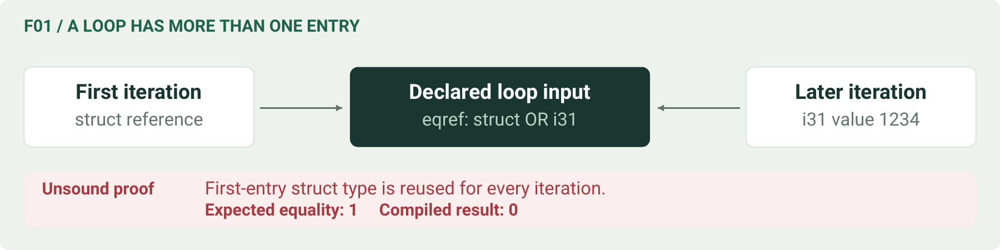
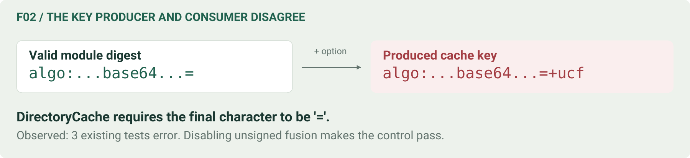

# Endive fork audit — 25 October 2026

<!-- DESIGN:BEGIN front -->


**[Read the designed PDF](output/pdf/Endive_Fork_Audit_2026-10-25.pdf)** ·
[Reproducers and evidence](compiler/docs/data/fork-audit-2026-10-25/) ·
[Change sequence](#7-proposed-change-sequence-and-acceptance-matrix)

### Reading guide

| Your purpose | Start here |
| --- | --- |
| Understand the decision in two minutes | [Assessment](#1-assessment) and [findings register](#findings-at-a-glance) |
| Review the compiler regressions | [F01: loop typing](#f01--p1-loop-inputs-retain-an-unsound-first-iteration-type) and [F02: cache keys](#f02--p1-option-suffixes-break-the-real-directory-cache) |
| Plan implementation | [Prioritized work packages and acceptance matrix](#7-proposed-change-sequence-and-acceptance-matrix) |
| Present the work | [Presentation outline](#8-presentation-outline); the PDF provides one page per finding |

**Contents:** [Assessment](#1-assessment) · [Scope and existing changes](#2-snapshot-scope-and-evidence-boundaries) ·
[Correctness](#3-correctness-and-execution-findings) · [Performance and evidence](#4-performance-and-evidence-findings) ·
[Build and maintenance](#5-build-automation-and-maintainability-findings) · [Validation](#6-validation-performed) ·
[Change sequence](#7-proposed-change-sequence-and-acceptance-matrix) · [Presentation](#8-presentation-outline)

---
<!-- DESIGN:END -->

**Audited revision:** `907750cfddb112c635d1af2e5375dbecc79de262`, branch
`fuse-branch-conditions`. **Comparison:** locally available upstream `1580f5349ae0ce9a771fa42ee8397ba6d2553685`.
**Deliverable:** an audit and proposed changes. Production sources have not been repaired in this audit.

**Second pass (same day):** findings re-verified against the **latest upstream**
`bce75ae684c56d7f240fd00892f863d34d3071b3` (`bytecodealliance/endive` `main`, 23 October 2026,
fetched for this pass) and against a conflict-free merge of the fork with it; two findings added
(F13, F14), and F01–F04 and F09 annotated. Evidence:
[`upstream-recheck/`](compiler/docs/data/fork-audit-2026-10-25/upstream-recheck/). The overview
figure and the designed PDF still show the first pass (F01–F12) only.

**Fix status (third pass, same day):** the branch was rebased onto `bce75ae6` (closes F13) and
every finding except F11 has a fix commit, local and unpushed; F04's cross-instance tail call
itself remains unsupported. See [section 9](#9-fix-status).

## 1. Assessment

The fork contains useful, reasonably well isolated compiler work: comparison fusion, repairs to
the large-argument ABI, wide result packing, smaller switch encodings, and narrowing of redundant
64-bit computations. It also has much stronger documentation and regression fixtures than a typical
experimental branch. Several choices show good restraint: branchless booleans remain off by default,
and tuple forwarding was excluded when its runtime benefit could not be established.

**The current integration branch nevertheless has two confirmed fork regressions:**

1. A valid GC-reference loop silently returns the wrong answer after `ref.eq` fusion.
2. The compiler's new cache keys break the supplied `DirectoryCache`, including its default use
   on the Java 21 JVM used for this audit. All three existing directory-cache tests fail.

There are also inherited tail-call limitations, an unresolved switch-performance regression already
documented in the repository, and weaknesses in the benchmark reducers and automation. Passing the
large specification suite does not establish that these interactions are correct.

**Recommended order:** repair the two fork regressions first; repair cancellation and establish the
cross-instance tail-call contract; then harden switch policy, evidence handling, and CI. Keep broad
refactoring behind those correctness changes.

**Second pass against the latest upstream.** Upstream gained five commits after the comparison
commit. One of them (#242) fixes an inherited **silent wrong-function call**: entries that a table
initialiser expression puts into an exported table are executed in the *importing* instance. The
fork still has that bug in every interpreter/compiler pairing (F13). The fork merges with upstream
without conflicts, and the merge passes all suites the first pass ran except the directory cache
(F02, unchanged). A full upstream build confirms that F01 and F02 are fork-only, and that F03, F04
and the CI weakness (F09) are still present upstream. A validator gap rejects valid GC modules that
use `ref.null none` where `eqref`, `structref`, `arrayref` or `i31ref` is expected, in the fork and
upstream alike (F14). A 286,448-case differential test of numeric condition fusion and narrowing,
eleven reference-merge shapes, and mixed-engine large-argument calls found no further defects.

**Revised order:** merge upstream first (closes F13 at no conflict cost), then the order above;
F14 is a one-line inherited fix best contributed upstream.

### Findings at a glance

P1 means a high-priority correctness or operational failure. P2 means a significant limitation,
regression, or validation weakness. P3 means maintainability or documentation work. These are audit
priorities, not CVSS scores. No sandbox escape or security exploit was established.

| ID | Priority | Finding | Attribution | Evidence |
| --- | --- | --- | --- | --- |
| F01 | P1 | Loop parameter types make `ref.eq` fusion unsound | Fork regression | Wrong result reproduced; upstream compiler control is correct |
| F02 | P1 | New option suffixes violate `DirectoryCache`'s key contract | Fork regression | Option matrix, default failure, three existing test errors |
| F03 | P1 | Tail-call cycles do not observe thread interruption | Inherited | Direct, indirect, and reference tail cycles reproduced in both engines |
| F04 | P2 | Cross-instance indirect tail calls reject valid linked programs | Inherited | Ordinary call returns 42; tail call throws in both engines |
| F05 | P2 | Switch selection optimizes bytes without a runtime policy | Fork; previously known | Current source plus archived local bisection |
| F06 | P2 | Output comparison can erase wrong results or accept a missing arm | Fork benchmark tooling | Negative controls reproduced |
| F07 | P2 | Statistical reducer silently truncates unequal sample arrays | Fork benchmark tooling | Three upstream samples / one fork sample accepted as n=3 |
| F08 | P2 | Published benchmark evidence cannot replay the full output claim | Fork evidence packaging | 74 saved outputs; two per cell, rather than 24 |
| F09 | P2 | CI configuration does not provide a firm gate for the integration branch | Inherited configuration | Branch filter and unconditional `continue-on-error` |
| F10 | P2 | Maven isolation wrapper accepts alternative repository overrides | Fork build tooling | Split `-D` bypass demonstrated with a fake Maven |
| F11 | P3 | Compiler bookkeeping and boxing logic are duplicated | Mixed | Source inspection; concrete cleanup boundaries below |
| F12 | P3 | Current fork overview contradicts its own implementation status | Fork documentation | `ref.eq` is simultaneously described as deferred and implemented |
| F13 | P1 | Table-initialiser entries run in the importing instance (fixed upstream, missing in fork) | Inherited; fork behind upstream | Wrong result (−1, expected 42) in all four engine pairings; upstream and merge return 42 |
| F14 | P2 | Validator rejects `(ref null none)` where abstract `eq`/`struct`/`array`/`i31` is expected | Inherited; present upstream | Five wasm-tools-valid modules rejected by fork and upstream; swapped arguments in `heapTypeSubtype` |

Second-pass status of the earlier findings against upstream `bce75ae6`: F01 and F02 fork-only (a
full upstream build returns the correct loop result and passes the directory-cache tests); F03, F04
and F09 still present upstream; F05–F08, F10–F12 concern fork-only files.

## 2. Snapshot, scope, and evidence boundaries

The working tree was clean at the start. The integration branch includes the locally cached upstream
comparison commit. The cached `origin/fuse-branch-conditions` is five commits behind HEAD; those five
commits are documentation changes. No fetch or push was performed, so this is **not** a statement
about the current state of GitHub. Local `main` is a different, older reference and was not used as
the upstream baseline.

Relative to the comparison commit, the branch changes 1,115 files, with 184,581 added and 276 removed
text lines; binary files are included in the file count. Of these:

| Area | Files | Added text lines | Removed text lines |
| --- | ---: | ---: | ---: |
| Production Java, including JMH sources | 24 | 1,806 | 212 |
| Tests and corpus fixtures | 47 | 7,975 | 61 |
| `compiler/docs/` notes and evidence | 1,036 | 174,035 | 0 |
| Other build files and documentation | 8 | 765 | 3 |

The review concentrated on the fork delta and its interactions with parser types, JVM signatures,
reference representation, compiler caching, call dispatch, cancellation, build isolation, and benchmark
claims. Relevant inherited runtime paths were inspected where they affect those features. This is
not a line-by-line review of every WASI host call, the Rust native backend, or every dependency.

Fresh checks used OpenJDK **21.0.12.1**, Maven **3.10.0**, Linux x86-64, and Java release-11
compilation settings. Maven dependencies and installs were isolated in
`/tmp/endive-audit-20261025/m2`, copied from the existing fork repository. No fork artifacts were
installed in the shared Maven repository. The initial read-only-cache lock failure and a later
offline missing-dependency failure were environment/setup failures; the directory-cache failure is
an actual test failure after dependency resolution succeeded.

The diagnostic sources, tiny binary modules, output, hashes, and test summary are under
[`compiler/docs/data/fork-audit-2026-10-25/`](compiler/docs/data/fork-audit-2026-10-25/).
The binary fixtures were assembled and validated with the checkout's Java `Wat2Wasm` tooling; the
saved probes execute the binary inputs directly. Compiled probes request `InterpreterFallback.FAIL`.

### What is already changed in the fork

| Change family | Resulting behavior and benefit | Remaining qualification |
| --- | --- | --- |
| Branch-condition fusion | Compare results consumed immediately by branches/selects can become JVM conditional branches, removing intermediate 0/1 materialization | F01 shows that reference-type proofs are incomplete |
| Constant and null-condition fusion | Zero tests, selected unsigned bounds, and null checks use shorter branch forms | Keep signedness, NaN behavior, and all reference representations in the regression matrix |
| Large-parameter ABI | The unboxed limit is 251 JVM argument slots; larger calls use `long[]` and, when needed, `Object[]`; local-slot and indirect-dispatch handling were repaired | All call forms and cross-module paths must use the same ABI |
| Wide multivalue results | Result tuples exceeding the JVM helper-signature limit are packed inline using temporary locals | This fixes representability; it is not evidence that tuple allocation disappears |
| Compact `br_table` | Choose smaller table/lookup dispatch and preserve unsigned out-of-range behavior | F05: byte savings can slow execution |
| Narrowing and trivial intrinsics | Avoid redundant extension/wrap work; emit short JVM instructions or JDK calls directly | Correctness and method-size checks remain distinct from runtime benefit |
| Runtime comparison options | Unsigned i32 fusion follows the running JVM/workaround policy; branchless booleans remain opt-in; build-time unsigned fusion defaults off | F02 breaks persistent directory caching when an option is enabled |
| Build and test hygiene | Versioned wasm-tools downloads, forced-workaround tests, current approval rendering, isolated Maven wrapper, real Binaryen splitter fixtures | F09/F10 remain; wrapper use is a convention rather than an enforced artifact identity |

The shared LEB128-reader work is on separate branches, not in the audited integration code. The
signed block-type repair is already part of the upstream ancestry; it should not be presented as a
new outstanding integration-branch change.

### Upstream drift since the comparison commit (second pass)

A read-only fetch on 25 October 2026 moved `upstream/main` from the comparison commit `1580f534`
to `bce75ae6`. A fetch of `origin` showed the GitHub `fuse-branch-conditions` unchanged at
`44f68a6f`, still five documentation commits behind the audited HEAD.

| Upstream commit | Content | Relevance to the fork |
| --- | --- | --- |
| `1cd6d40d` (#242), 20 Oct | Redline native runners execute `call_indirect` to another instance's function in that instance; **`Instance` now records the defining instance as owner of table-initialiser entries, for every machine** | Fixes F13, which the fork still has. Confirms F04: “The interpreter and the JVM compiler reject that case outright”; Redline runs it as a nested call |
| `7ba980b9` (#248), 21 Oct | `MemoryTest` atomics test on its own executor; CI job `timeout-minutes: 60` | Test robustness; F09's `continue-on-error: true` is unchanged |
| `9d38cf9f`, `bc7a9f73`, `bce75ae6` | Dependabot: central-publishing plugin 0.12.0, `jackson-databind` 2.22.4, Android JUnit 5 plugin | Build only; offline fork builds need the new `jackson-databind` |

`git merge-tree` merges the audited HEAD with `bce75ae6` without conflicts; the five commits touch no
file the fork changed. Older upstream topic branches
(`fix/memcopy-megamorphic-warmup`, `security-audit-fixes`, `fix/call-indirect-cross-module-type-index`
and others, last touched May–July 2026) were inspected by commit log only and are not part of `main`.

<!-- DESIGN:BEGIN pipeline -->

<!-- DESIGN:END -->



This explains the two principal risks: an incorrect type proof changes semantics before bytecode
emission, while an incompatible cache key prevents the compiler from reaching that stage at all.

## 3. Correctness and execution findings

### F01 — P1: loop inputs retain an unsound first-iteration type

**Sources:** [`TypeStack.java`](compiler/src/main/java/run/endive/compiler/internal/TypeStack.java),
lines 63–75; [`WasmAnalyzer.java`](compiler/src/main/java/run/endive/compiler/internal/WasmAnalyzer.java),
the `BLOCK`/`LOOP` handling and `REF_EQ` case around lines 1748–1767.

`TypeStack.enterScope` records the scope and prepares a restored result stack, but does not replace
the active parameter types with the declared scope parameter types. For a loop this matters: later
iterations can supply a different subtype through the loop label. The first entry's concrete subtype
is not a proof about all iterations.

The fork uses those types to mark `ref.eq` as `REF_EQ_FUSABLE` if either operand excludes i31 values.
Fusion can then emit JVM object-identity comparison. The new block-exit widening protects several
merge cases, but does not protect loop-entry parameters.

<!-- DESIGN:BEGIN loop -->

<!-- DESIGN:END -->


**Reproducer:** [`loop-ref-eq.wat`](compiler/docs/data/fork-audit-2026-10-25/loop-ref-eq.wat).
The loop declares an `eqref` input. Its initial value is a struct; its second input is an i31 value
1234. Inside the loop, the input is compared with a separately created i31 value 1234, and the result
is consumed by `if`. The second comparison must succeed. The declared loop type permits that value;
the [WebAssembly loop validation rule](https://webassembly.github.io/spec/core/valid/instructions.html#valid-loop)
uses the loop's input types for its label. The
[reference-equality rule](https://webassembly.github.io/spec/core/exec/instructions.html#exec-ref-eq)
compares Wasm reference values.

```text
fork:              loop_ref_eq interpreter=[1] compiler=[0]
upstream compiler: loop_ref_eq interpreter=[1] compiler=[1]
```

The upstream control was freshly compiled from the pinned upstream compiler sources in `/tmp`,
using the current checkout's parser/runtime and the same ASM dependencies. It isolates the compiler
change; it is not a complete separately rebuilt upstream distribution.

**Impact:** silent wrong results for valid GC programs, without fallback or a verifier error. This
is more serious than a size/performance regression. Changing the unsigned-comparison option does
not disable reference-equality fusion.

**Proposed change:** widen loop parameters to their declared types before analyzing the loop body.
A conservative rule that retypes all block parameters is also possible. If shipping a narrower
immediate repair, disable reference-identity fusion until the type proof is sound. Do not weaken
i31 equality to identity in the runtime helper.

**Acceptance:** this fixture returns 1 in both engines; include `if`, `br_if`, and `select` consumers,
multiple loop parameters, nested loops, nullable values, and all compiler option combinations. Keep
the existing block/if/select merge fixtures and verify the emitted opcode as well as the answer.

**Second pass.** A complete build of upstream `bce75ae6` (not only its compiler sources) returns
`compiler=[1]` on the fixture, so the regression is the fork's. The merged tree still returns
`[0]`. A broader differential module
([`gc.wat`](compiler/docs/data/fork-audit-2026-10-25/upstream-recheck/gc.wat)) exercises eleven
other ways a narrower reference can reach `ref.eq`: block results via `br_if` and `br_table`,
if/else merges, `select (result eqref)`, `br_on_cast`, `br_on_cast_fail`, `br_on_null`,
`br_on_non_null`, a mutable global read through `local.tee`, and typed nulls. All agree with the
interpreter under all four option settings; only the loop-parameter shape differs. Source reading
agrees: `block` and `if` parameters cannot be re-entered, and locals, globals, fields, calls and
`select_t` push declared types, so loop parameters are the only unsound type source found.

### F02 — P1: option suffixes break the real directory cache

**Sources:** [`MachineFactoryCompiler.java`](compiler/src/main/java/run/endive/compiler/MachineFactoryCompiler.java),
lines 152–160; [`DirectoryCache.java`](dircache/src/main/java/run/endive/experimental/dircache/DirectoryCache.java),
lines 19–20 and 112–123.

The compiler appends `+ucf` and/or `+bb` to `module.digest()`. The directory cache requires the digest
portion to match `^[A-Za-z0-9+_\-/]+=$`, with its padding `=` at the end. Appending a suffix after
that padding violates the contract. `get()` catches `IOException`, not this
`IllegalArgumentException`, so the error aborts compilation rather than behaving as a cache miss.

<!-- DESIGN:BEGIN cache -->

<!-- DESIGN:END -->


| Unsigned fusion | Branchless booleans | Directory-cache compile |
| --- | --- | --- |
| off | off | succeeds |
| on | off | `IllegalArgumentException` |
| off | on | `IllegalArgumentException` |
| on | on | `IllegalArgumentException` |
| runtime defaults on this Java 21 JVM | off | `IllegalArgumentException` |

The expanded Maven build independently confirms the same defect: **3 tests, 3 errors** in
`DirectoryCacheTest` (native filesystem, in-memory filesystem, concurrent access). The compiler's
own in-memory cache test accepts arbitrary strings and therefore passes. As a control, rerunning
the existing directory-cache tests with `-Dendive.compiler.unsignedCompareFusion=false` passes all
three. This isolates the option-key interaction; it does not repair the default or the branchless
option.

**Proposed change:** define one versioned cache-key codec and hash a canonical representation of the
module digest, compiler ABI/version, and code-generation options into a valid digest. Preserve the
`Cache` contract or deliberately version it with every implementation updated together. Merely
loosening this regex addresses the exception but leaves versionless reuse of old generated code
unresolved. Other builder choices that affect generated code or execution policy also need a clear
cache contract.

**Acceptance:** run the real directory-cache tests under defaults on supported JDKs; add all four
option combinations, repeat hits, distinct keys for distinct settings, and a version/ABI mismatch
that becomes a miss. Invalidate old entries rather than accidentally loading pre-repair code.

**Second pass.** Upstream `bce75ae6` passes `DirectoryCacheTest` (3 tests, no errors); the merged
tree fails it exactly as the fork does (3 errors, same message). Merging upstream neither fixes nor
worsens F02.

### F03 — P1: cancellation is absent from tail-call cycles

**Sources:** [`Emitters.java`](compiler/src/main/java/run/endive/compiler/internal/Emitters.java),
`RETURN_CALL*` around lines 1517–1607;
[`Compiler.java`](compiler/src/main/java/run/endive/compiler/internal/Compiler.java),
`compileMachineCallWithTailCalls` around lines 1055–1130;
[`InterpreterMachine.java`](runtime/src/main/java/run/endive/runtime/InterpreterMachine.java),
`RETURN_CALL` around lines 2837–2907.

Ordinary compiled calls and backward branches have interruption checks. The compiled tail-call
emitters schedule another call, and the generated trampoline loops without an equivalent poll.
The interpreter's self-tail-call frame reset also has no check. These runtime paths predate the
fork delta.

The bounded diagnostic starts each worker, interrupts it, and allows one second to join. Ordinary
loops stop with `WasmInterruptedException`. Direct, indirect, and reference tail-call loops remain
alive in **both** engines. Workers are daemon threads in a short-lived process, so the diagnostic
does not leave runaway workers behind. One second is the probe interval, not a specified latency
guarantee; the absence of a poll is independently visible in the source.

**Impact:** an embedding application's timeout/cancellation can leave guest work consuming a worker
and its associated state. Repeated abandoned work can accumulate resources. This audit did not
measure retained-heap growth, and does not call allocation churn a memory leak.

**Proposed change:** put an interruption check on every tail-cycle path, with a central compiled
trampoline check and a check in the interpreter tail-call transition. Ensure calls resolved through
nested tail-call helpers receive the same guarantee.

**Acceptance:** bounded cancellation tests for direct/indirect/ref tail calls, mutual recursion,
compiled/interpreted mixtures, and reference arguments. Use worker cleanup that cannot hang the
test process. Check normal finite tail recursion and stack safety after adding the polls.

**Second pass.** Reproduced unchanged on upstream `bce75ae6` and on the merged tree: ordinary loops
stop, all six tail-cycle workers remain alive. This is a candidate upstream report rather than a
fork-only repair.

### F04 — P2: linked indirect tail calls are still unsupported

**Sources:** [`Shaded.java`](compiler/src/main/java/run/endive/compiler/internal/Shaded.java),
lines 105–143; `InterpreterMachine.RETURN_CALL_INDIRECT` around lines 2908–2931.

A table entry referring to another `Instance` is explicitly rejected by both implementations.
The compiled error says “different Machine implementation”, but the check actually rejects a
different instance even when both instances use the same compiler implementation.

The supplied provider exports a table containing a function returning 42. A consumer imports that
table through `Store`. Calling the entry normally returns 42 in either engine; replacing it with
`return_call_indirect` throws the unsupported-operation engine exception. See
[`cross-provider.wat`](compiler/docs/data/fork-audit-2026-10-25/cross-provider.wat) and
[`cross-consumer.wat`](compiler/docs/data/fork-audit-2026-10-25/cross-consumer.wat).

**Impact:** valid multi-module embeddings fail on a call form that works within one module. This
is inherited, rather than caused by the new large-parameter fixes.

**Proposed change:** carry the destination instance in pending-tail-call state and make the
trampoline switch instance, memory, and type context correctly. A plain recursive Java call is
insufficient because it loses the tail-call stack guarantee. Until implemented, document this
boundary explicitly and correct the misleading compiled error message.

**Acceptance:** same-engine and mixed-engine cross-instance calls, numeric and reference arguments,
multivalue results, incompatible types, and long mutually tail-recursive linked modules. Decide
whether an initial supported subset is acceptable before presenting tail-call support as complete.

**Second pass.** Unchanged on upstream `bce75ae6` and the merged tree (ordinary 42, tail
`WasmEngineException` in both engines, with the same misleading compiled message). Upstream's #242
commit message states the limit explicitly: the interpreter and the JVM compiler reject a
`return_call_indirect` to another instance, while the Redline native runners now execute it as a
nested call, which uses stack per hop. Upstream has thus chosen a *nested-call* subset for native
code; a JVM-side repair should state whether it follows that subset or provides a real cross-instance
trampoline. The ordinary (non-tail) boxed-ABI path is sound across instances: a probe of
`call_indirect` with 252 `i32` parameters, and with an `externref` plus 254 `i32` parameters,
returns the expected results for all four interpreter/compiler pairings (the fork's own test covers only same-engine pairs).

### F13 — P1: table-initialiser entries run in the importing instance

**Sources:** [`Instance.java`](runtime/src/main/java/run/endive/runtime/Instance.java), table
initialisation, lines 136–150; upstream fix `1cd6d40d` (#242), seven lines in the same place.

A table may declare an initialiser expression, for example `(table (export "tab") 2 funcref
(ref.func $answer))`. Every slot then holds `$answer`. The fork's `Instance` records an owner only for
object-reference initialisers (`setObjRef(j, ref, this)`); a `funcref` initialiser value goes into
the table without one. An instance that imports the table and executes `call_indirect` on such a
slot treats the function index as one of its *own* functions. Upstream describes the defect as present in the interpreter and the JVM
compiler and fixed it in `Instance` for every machine.

**Reproducer:** upstream's corpus pair
[`table_init_owner-export.wat`](compiler/docs/data/fork-audit-2026-10-25/upstream-recheck/table_init_owner-export.wat)
and [`table_init_owner-import.wat`](compiler/docs/data/fork-audit-2026-10-25/upstream-recheck/table_init_owner-import.wat).
The importer's own function at the same index returns −1; the exporter's `$answer` returns 42.

```text
fork (all four caller/definer pairings):     result=-1   ownerRecorded=false
upstream bce75ae6 and fork+upstream merge:   result=42   ownerRecorded=true
```

**Impact:** silent wrong results — a different function runs, with the importer's globals, memory
and tables — whenever a linked module calls through an imported table filled by an initialiser
expression. If the importer has no function at that index, or one of another type, the call should
trap or fail its type check instead (not probed). It is inherited, not caused by the fork's
changes, but the fork currently ships behind an available upstream fix. No fork test reaches it; the first pass's
specification suite passes with it.

**Proposed change:** merge `upstream/main` (no conflicts; all suites of the first pass pass on the
merge except F02, and upstream's four new `MachinesTest` cases pass). Adopt a standing rule: before
an integration-branch measurement or release, record the upstream commit merged and rerun the
suites. Prefer the merge to cherry-picking the `Instance` hunk: #242 also moves Redline's `.native`
format to version 4 together with the runner code that reads it, and keeping whole upstream commits
makes later merges and attribution simpler.

**Acceptance:** upstream's `shouldCallTableInitialiserInItsDefiningInstance` passes for all four
pairings in the fork's `machine-tests` (253 tests on the merge: the fork's 249 plus these four);
add a variant where the initialiser is a global-derived `ref.func` and one where the importer has no
function at that index.

### F14 — P2: the validator rejects `ref.null none` as an abstract `eq`/`struct`/`array`/`i31` value

**Source:** [`ValType.java`](wasm/src/main/java/run/endive/wasm/types/ValType.java),
`heapTypeSubtype`, the `none` case (lines 405–408; identical upstream, introduced with WasmGC
support in `ae72d5b5`).

```java
if (ht1 == TypeIdxCode.NONE.code()) {
    return heapTypeSubtype(TypeIdxCode.ANY.code(), ht2, ts)   // asks "any <: ht2"
            || ht2 == TypeIdxCode.ANY.code()
            || (ht2 >= 0 && ts != null && isConcreteInAnyHierarchy(ht2, ts));
}
```

The first operand pair is swapped: it tests whether `any` is a subtype of the target, which is false
for every target except `any`. `none` is therefore accepted where `anyref` or a concrete struct/array
type is expected, but rejected where `eqref`, `structref`, `arrayref` or `i31ref` is expected. The
[subtyping rules](https://webassembly.github.io/spec/core/valid/matching.html) make `none` the
bottom of the whole `any` hierarchy.

**Reproducer:** five modules, each validated by wasm-tools, rejected by fork and upstream with
`type mismatch: instruction requires [refnull[-19]] but stack has [refnull[-15]]`
(`none*.wat` in the evidence directory): `ref.eq` on `(ref.null none)` with itself, with a struct and
with a typed null, and a call passing `(ref.null none)` to an `eqref` parameter.

**Impact:** valid GC programs fail at load time with `InvalidException`; no wrong result. Producers
canonicalise nulls to the bottom heap type (Binaryen types every null of the `any` hierarchy as
`(ref null none)`), so GC toolchain output can hit this; no real workload was tried here. It also
limits differential testing of F01 itself: the second pass had to avoid `ref.null none` in its
reference fixture.

**Proposed change:** `return ht2 == TypeIdxCode.ANY.code() || heapTypeSubtype(ht2,
TypeIdxCode.ANY.code(), ts);` — the existing concrete-type branch already answers `ht2 <: any` for
struct and array types. Contribute it upstream with a spec-style test; carry it in the fork only if
a thesis workload needs it before upstream merges it.

**Acceptance:** the five modules validate and run identically in both engines; `none` remains
rejected for `func`, `extern`, `exn` and concrete function types; the specification suite and its
skip list are unchanged.

## 4. Performance and evidence findings

### F05 — P2: byte-minimal switch selection can slow large dispatchers

**Source:** [`SwitchEmitter.java`](compiler/src/main/java/run/endive/compiler/internal/SwitchEmitter.java),
lines 17–48. Existing evidence:
[`workload-ab-2026-10-18.md`](compiler/docs/workload-ab-2026-10-18.md), “Synthetic case: rustvm-base”.

The encoding decision primarily compares `12 + 4*n` table bytes with `8 + 8*k` lookup bytes.
The 8000-byte constant gates an additional default-target transformation; it does not prevent the
ordinary sparse lookup conversion in a method that remains too large for the JVM's usual JIT path.

The repository already records a **12.6% local slowdown** on `rustvm-base`, attributed by bisection
to the compact switch change. Forcing `tableswitch` removed the slowdown in that experiment.
The saved method was about 16.6 kB, and the saving was only 84 bytes. Those measurements were
inspected here, **not rerun**, and remain laptop diagnostics. Excluding synthetic cells from the
headline workload table does not resolve a regression in a dispatch shape that real code can use.

**Proposed change:** make dispatch selection an explicit policy: speed-oriented versus
size-constrained, or a carefully measured density/size heuristic with method-size context. Preserve
the valuable sparse-table size reduction near an actual JVM method limit. Measure the policy rather
than assuming that an exact byte-minimum is a speed optimum.

**Acceptance:** retain selector/default correctness tests; compare dense, moderately sparse, and
very sparse tables in small, near-8-kB, large interpreted, and near-64-kB methods. Include the saved
regression case and a real interpreter dispatcher. Record exact method sizes and separate JVM
interpreter, JIT, and Wasm-interpreter fallback behavior.

### F06 — P2: output equality is not a reliable correctness gate

**Source:** [`summarize.py`](compiler/docs/data/workload-ab-2026-10-18/summarize.py), lines 31–47
and 75–80; [`campaign.sh`](compiler/docs/data/workload-ab-2026-10-18/campaign.sh), metric-line extraction.

`normalized()` discards every line beginning with `{`, rather than recognizing just the harness's
telemetry record. Thus guest results `{"answer":1}` and `{"answer":2}` normalize to the same empty
output. Its generic timing regex can also erase differing guest data that happens to look like a
duration. The negative controls reproduce both cases.

`outputs_match()` does not require both arms or the planned number of rounds. A directory containing
only `up.r1.out` is reported as **`yes (1)`**. A mismatch is rendered as text; it does not make the
summary process fail. These are properties of the checker, not proof that a saved workload produced
an incorrect answer.

**Proposed change:** keep guest stdout, guest stderr, and harness telemetry in separate channels or
files. Normalize only explicitly specified volatile fields for each workload, and preserve a hash
of the unmodified output. Require every arm/round and fail the campaign's publication gate when
correctness is missing or mismatched. Give diagnostic-only report generation an explicit mode.

**Acceptance:** reject different guest JSON, a missing arm, a missing round, empty guest output where
output is expected, and changed result fields next to timing fields. Accept known harmless timing
variation without deleting unrelated guest data.

### F07 — P2: unequal timing arrays produce a confident-looking partial result

**Sources:** `summarize.py`, lines 21–28;
[`plot.py`](compiler/docs/data/workload-ab-2026-10-18/plot.py), `delta()`.

`zip(a, b)` silently stops at the shorter array. The reducer then reports `len(a)` as n, even
though it used fewer pairs for the effect and interval. For `up=[100,100,100]`, `fork=[90]`, the
current code accepts the input, reports n=3, and returns a −10% change with a degenerate interval
excluding zero. The plotter repeats the same pairing pattern.

**Current-data check:** all **111** published `results.<metric>.json` arrays in the main 37-cell
archive have equal nonempty arm lengths and positive samples. This finding identifies a missing
guard; it does **not** establish that their current numeric estimates are wrong.

**Proposed change:** validate planned arms, sample counts, round identities, finite positive values,
and completion status before statistics or plots. Pair by explicit round ID, not just array position.
Factor the checks and effect calculation into one shared reader used by summary, table, and plot.

**Acceptance:** incomplete, mismatched, duplicate, zero, negative, NaN, and infinite samples fail
with an actionable error. A fully validated archive regenerates the same estimates. Keep 12-round
exploratory intervals separate from any stronger fixed-runner acceptance criterion.

### F08 — P2: the saved archive cannot reproduce the full output-comparison claim

**Sources:** [`workload-ab-2026-10-18.md`](compiler/docs/workload-ab-2026-10-18.md), summary,
limitations, and reproduction section; its `data/` directory and campaign script.

The headline says guest output is identical across all 24 samples per cell. The repository retains
**74 output files for 37 cells**, one per arm and cell. Its current summary JSON reports `yes (2)`
for every cell. The limitations correctly disclose that all 24 outputs were checked in an external
bench directory, but those complete inputs or per-round normalized hashes are absent here.

The campaign also requires machine-specific absolute thesis paths, untracked classpath files and
compiled harness directories, and split modules outside this checkout. The 37-cell directory does
not contain its own `EndiveRun.java`; the reproduction recipe assumes the reader can locate the
matching harness elsewhere. A complete fresh-clone replay therefore needs manual reconstruction.

**Impact:** current saved output equality is independently checkable for one pair per cell. The
stronger historical all-round statement cannot be re-established from this archive alone. This is
an evidence-completeness issue, not evidence of fabricated results.

**Proposed change:** publish an immutable manifest with engine and harness source identities, full
JAR hashes, input/module identities, commands, round IDs, exit status, and raw/normalized output
hashes for every sample. Retain or provide content-addressed retrieval for the raw outputs. Add a
configuration-driven replay script and a verifier that fails on missing archive members.

**Acceptance:** a clean checkout plus declared dependencies verifies every claimed pair and
regenerates figures without guessing paths or obtaining undocumented scratch files. Historical
claims that cannot be recovered should say exactly which subset remains replayable.

## 5. Build, automation, and maintainability findings

### F09 — P2: the configured CI gate is weaker than the fork needs

**Source:** [`.github/workflows/ci.yaml`](.github/workflows/ci.yaml), lines 3–14.

The workflow runs on pushes to `main` and on pull requests, but has no push trigger for
`fuse-branch-conditions`. A plain push to the integration branch is therefore insufficient to
trigger this workflow unless associated pull-request activity supplies a trigger. In addition,
the main CI matrix uses unconditional job-level `continue-on-error: true`.
[GitHub documents](https://docs.github.com/en/actions/reference/workflows-and-actions/workflow-syntax#jobsjob_idcontinue-on-error)
that this allows the workflow run to pass when that job fails. Individually required checks and
branch protection are separate settings and were not inspected.

This is inherited configuration, not a fork-introduced YAML change. It is particularly relevant now:
the default Java 21 directory-cache tests actually fail, while the compiler-only tests pass.

**Proposed change:** add a fork-specific push/manual workflow for the integration branch, and make
the supported correctness matrix blocking. Limit tolerated failures to explicitly experimental
legs. Include directory caching and the new regression fixtures, rather than relying only on
compiler-module tests.

**Acceptance:** inspect one deliberate failing run to confirm the required gate fails, and a
complete passing run to establish the supported baseline. YAML configuration alone does not prove
a live run occurred or that branch protection enforces it.

**Second pass.** Upstream `7ba980b9` (#248) added `timeout-minutes: 60` to the CI job after a
`MemoryTest` hang held macOS runners for six hours; `continue-on-error: true` and the `main`-only
push trigger remain. Merging upstream brings the timeout into the fork; it does not make the gate
blocking.

### F10 — P2: the Maven repository guard recognizes only one argument spelling

**Source:** [`scripts/mvn-fork.sh`](scripts/mvn-fork.sh), lines 22–28 and 44;
[`AGENT.md`](AGENT.md), build examples.

The wrapper rejects `-Dmaven.repo.local=...` but accepts Maven's standard split form
`-D maven.repo.local=...`; long `--define` forms also need handling. It appends user arguments after
its own property, leaving a second repository definition on the command line. The fake-Maven probe
shows both definitions being forwarded. No unsafe install was performed to demonstrate this.

The protection also depends on using the wrapper at all: the checkout's working instructions still
recommend ordinary `mvn install`, and the fork shares `run.endive:*:999-SNAPSHOT` coordinates with
the thesis engine. This matters because isolation was explicitly introduced to prevent accidental
benchmark-engine replacement.

**Proposed change:** parse/reject all repository override forms, or enforce an effective repository
after argument processing. Update fork-local build instructions to use the wrapper. For a stronger
boundary, give local fork artifacts an unambiguous identity and retain engine stamps in consumers.

**Acceptance:** test joined/split `-D`, short/long `--define`, symlinked repository paths, normal Maven
arguments, and a normal isolated install. Confirm the shared repository's relevant artifact hashes
remain unchanged. Treat this as accidental-configuration protection, not a hostile-user sandbox.

### F11 — P3: repeated bookkeeping makes future ABI changes harder to review

**Sources:** `Compiler.java` (2,348 lines), `Emitters.java` (2,427), `WasmAnalyzer.java` (2,213);
[`NarrowingPeephole.java`](compiler/src/main/java/run/endive/compiler/internal/NarrowingPeephole.java),
[`BranchCondition.java`](compiler/src/main/java/run/endive/compiler/internal/BranchCondition.java).

There are repeated stack-to-local spills, numeric/object argument-array construction, and result
boxing paths across compiler bridges and emitters. They differ for good reasons, but their shared
slot/index rules are easy to change inconsistently. The comparison vocabulary is also spread across
opcode definitions, boolean-producer sets, branch-condition maps, and branchless-boolean kinds.
Several tables encode related facts separately.

These are maintenance risks, not additional demonstrated wrong results. The explicit condition enum,
small `SwitchEmitter`, and central argument-slot helpers are useful existing abstractions. Preserve
that readability rather than replacing it with a generic optimization framework.

**Proposed change:** after the correctness fixes, extract a small typed description of JVM argument
layout and shared boxing/spill operations. Centralize only comparison properties that really are
shared. Make internal type-stack invariants explicit: for example, unexpected missing scope data or
too few result entries should be diagnosed rather than silently skipped in `exitScope`.

**Acceptance:** no behavioral or generated-size changes on the existing corpus; structural checks
for every bridge, references, wide values, and result tuples. Keep refactoring separate from semantic
repairs so a reviewer can assess each diff.

### F12 — P3: the overview mixes historical snapshots with current claims

**Source:** [`FORK_CHANGES.md`](FORK_CHANGES.md), particularly lines 273–281 and its later
implementation-status table.

One section says `ref.eq` is deferred because select typing is unsound. A later section says sound
select/scope typing and `ref.eq` fusion are implemented. The current source agrees with the latter,
subject to F01's loop gap. The overview's opening snapshot and older “final” test counts also require
careful date interpretation. Historical notes are useful, but current-tense statements should not
contradict one another.

**Proposed change:** put one current status table at the top, pin each validation result to a code
revision and scope, and label older conclusions as historical. Link the switch candidate to its
known regression and the integration branch to this audit's remaining correctness failures.

**Acceptance:** a new reader can tell which changes are integrated, separate-branch, deferred,
experimentally rejected, locally tested, or awaiting a stronger measurement gate without reconciling
several snapshots manually.

## 6. Validation performed

Commands use an isolated Maven repository. The first compiler-focused reactor succeeded with
strict checks enabled. A broader install then built the supporting modules and passed the compiler
specification tests, but failed at `dircache`; its machine-tests module was skipped as a consequence.
The separate machine-test reactor succeeded. The directory-cache diagnostic with unsigned fusion
disabled is a control, not a passing result for the defaults. The adjacent evidence summary records
both runs separately from the failed default build.

```sh
mvn -o -Dmaven.repo.local=/tmp/endive-audit-20261025/m2 -pl compiler -am test
mvn -Dmaven.repo.local=/tmp/endive-audit-20261025/m2 \
  -pl compiler-tests,machine-tests,dircache -am install
mvn -o -Dmaven.repo.local=/tmp/endive-audit-20261025/m2 -pl machine-tests -am test
mvn -o -Dmaven.repo.local=/tmp/endive-audit-20261025/m2 -pl dircache \
  -Dendive.compiler.unsignedCompareFusion=false surefire:test
```

| Check | Observed result |
| --- | --- |
| Compiler unit tests | 57 tests per classpath/module-path execution; no failures or errors |
| Parser unit tests | 34 per execution; no failures or errors |
| Runtime unit tests | 98 per execution; no failures or errors |
| Compiler tests/specification suite | 34,121 per execution, including 64 skips; no failures or errors, both classpath and module path |
| Forced memory-copy workaround execution | 1 test; passes |
| `wabt` tests | 6 per execution; passes |
| Java wasm-tools tests | 10 per execution; passes |
| Directory-cache tests under defaults | 3 tests, 3 errors; build failure matching F02 |
| Directory-cache tests with unsigned fusion explicitly disabled | 3 tests; passes as a diagnostic control |
| Separate machine-test reactor | 249 per classpath/module-path execution; no failures, errors, or skips |
| Focused audit probes | F01–F04, F06–F07 and the F10 argument forwarding reproduced |
| Published timing-array shape check | 111 files checked; no unequal/empty arrays or nonpositive samples |
| Historical switch regression | Code and saved evidence inspected; no fresh performance campaign |

Counts above are per execution, not doubled into a larger count of distinct tests. A successful
parser/runtime/spec test does not close a failing optimizer-interaction probe. No full clean reactor,
new fixed-runner timing campaign, Java 11/17/25 run, Android/device run, complete WASI suite, native
Redline execution, or exhaustive differential fuzz campaign was performed here.

### Second-pass validation (upstream re-check)

Three trees were exported from git objects into a scratch directory and built there, each with its
own isolated Maven repository seeded from the fork repository (no shared-repository installs):
the audited fork HEAD, upstream `bce75ae6`, and the conflict-free merge tree `b77f0eae`.

```sh
mvn -q -B -Dmaven.repo.local=$SCRATCH/m2-<tree> -Dquickly \
  -pl compiler,dircache,machine-tests,compiler-tests -am install      # each tree
mvn -B -o -Dmaven.repo.local=$SCRATCH/m2-merged -Dmaven.test.failure.ignore=true \
  -pl runtime,compiler,machine-tests,dircache,compiler-tests test     # merged tree
mvn -B -o -Dmaven.repo.local=$SCRATCH/m2-up -pl dircache test         # upstream control
```

| Check | Fork `907750cf` | Upstream `bce75ae6` | Merge `b77f0eae` |
| --- | --- | --- | --- |
| F01 loop `ref.eq` probe (expected 1) | 0 | **1** (full build) | 0 |
| F02 directory-cache matrix / `DirectoryCacheTest` | 4 of 5 settings throw | 3 tests pass | 4 of 5 throw; 3 tests, 3 errors |
| F03 tail-cycle interruption (6 workers) | all alive | all alive | all alive |
| F04 cross-instance `return_call_indirect` | throws (both engines) | throws (both engines) | throws (both engines) |
| F13 table-initialiser owner (4 pairings, expected 42) | **−1** in all four | 42 | 42 |
| F14 `ref.null none` as `eqref` (5 modules) | all rejected | all rejected | not run (no change to `wasm`) |
| Boxed-ABI cross-instance `call_indirect` (4 pairings) | pass | not run (fork test input) | pass |
| Numeric fusion/narrowing differential, 286,448 checks | 0 mismatches | — (fork options) | 0 mismatches |
| Reference-merge differential, 12 exports × 16 inputs × 4 settings | only `i_loop` (F01) | — (fork options) | only `i_loop` |
| Runtime / compiler unit tests | first pass | — | 98 / 57; pass |
| Specification suite | first pass | — | 34,121 incl. 64 skips; pass |
| `machine-tests` | first pass (249) | — | 253 (adds upstream's 4 table-owner cases); pass |
| F06/F07/F10 probes (fork-only files) | reproduced | — | reproduced |

The differential tests compare each compiled result (or trap class) with the interpreter for every
setting of `unsignedCompareFusion` × `branchlessBooleans`, with `InterpreterFallback.FAIL`. They
check answers, not emitted opcodes, and run mostly in the JVM bytecode interpreter; they would not
expose a C2-only miscompilation such as the JDK 11–17 `fold_compares` bug. Inputs and recorded output
are in [`upstream-recheck/`](compiler/docs/data/fork-audit-2026-10-25/upstream-recheck/); rerun with
its `run-recheck.sh` (same build prerequisites as `run-probes.sh`).

### Reproduce the focused diagnostics

After building the compiler and its dependencies in an isolated repository:

```sh
ENDIVE_AUDIT_M2=/tmp/endive-audit-20261025/m2 \
  bash compiler/docs/data/fork-audit-2026-10-25/run-probes.sh
```

The runner compiles diagnostic Java into a temporary directory, uses saved tiny Wasm inputs, and
prints the observed behavior. It is a diagnostic runner rather than a passing CI acceptance suite:
its successful process exit means that it completed, not that the demonstrated defects are fixed.
It neither repairs production sources nor publishes anything.

## 7. Proposed change sequence and acceptance matrix

| Work package | Change | Required acceptance | Closes |
| --- | --- | --- | --- |
| A — compiler semantics | Widen loop inputs; add independent semantic and structural regressions | Correct result and conservative fusion across loop/merge/consumer variants and compiler options | F01 |
| B — cache contract | Versioned valid keys; real-cache integration matrix | Default directory-cache tests pass; four option combinations and repeat hits; old ABI entries miss | F02 |
| C — tail execution | Poll cancellation; model pending destination instance | Finite and infinite direct/indirect/ref cases; mixed engines; cross-instance stack safety and results | F03, F04 |
| D — switch policy | Separate size constraints from dispatch-speed choice | Saved regression removed or explicitly selectable; sparse size benefits retained; exact sizes and runtime tiers recorded | F05 |
| E — benchmark integrity | Separate output/telemetry; strict round validation; archive verifier | Negative controls fail; complete historical subset replays; missing evidence reported accurately | F06–F08 |
| F — integration gate | Blocking supported CI; fork trigger; robust Maven isolation | Deliberate failure blocks gate; all override spellings checked; isolated build and engine provenance verified | F09, F10 |
| G — reviewability | Small ABI/layout cleanup and current overview | Behavior/bytecode unchanged for cleanup; one unambiguous implementation and validation status table | F11, F12 |
| H — upstream sync (do first) | Merge `upstream/main` (`bce75ae6`, conflict-free); record merged upstream commit with every validation; offer inherited fixes upstream | Upstream's table-owner test passes for all pairings; first-pass suites unchanged apart from F02; F14 fixed upstream or carried with a test; F03/F04 reported upstream | F13, F14 |

Keep each work package reviewable. H is a merge with no conflicts and should precede A/B, so
their fixes are validated on the current upstream base. A/B are small urgent repairs. Cross-instance trampolines and
switch-policy changes need more design and validation. Evidence repairs can proceed independently,
but old observations must not be upgraded to fixed-runner claims merely by improving their report.

## 8. Presentation outline

1. **Problem and contribution.** Wasm-to-JVM compilation needs to manage branch overhead, the JVM
   argument-slot limit, and method-size limits. The fork addresses each with targeted lowering and
   ABI changes. Show the change-family table in section 2.
2. **What worked.** Numeric condition fusion, wide result packing, and the large-argument repairs
   have substantial regression coverage. Existing local measurements suggest useful runtime and
   bytecode-size improvements; their exact evidence class remains part of the claim.
3. **Why optimizer proofs matter.** Show the two-iteration `eqref` loop: a struct on first entry,
   an i31 on the back edge. Both are legal; only the declared loop type is a sound general proof.
   The one-line outcome `interpreter=1, compiler=0` makes the remaining defect concrete.
4. **Why integration matters.** Compiler-only tests pass, but the real directory cache rejects the
   new option keys. Show the four-row matrix and the three existing test errors.
5. **Tradeoffs and inherited boundaries.** Smaller switch encoding is not always faster; tail-call
   support still needs cancellation and linked-instance coverage. Distinguish these from the two
   newly demonstrated fork regressions.
6. **Path forward.** Present work packages A–G, with correctness and cache compatibility first,
   then execution contracts, evidence integrity, and controlled performance validation.
7. **Staying current (second pass).** Upstream fixed a silent wrong-call bug five days after the
   fork's base; the fork still returns −1 where 42 is expected, until a conflict-free merge. Show
   the three-column table from section 6: which defects are the fork's, which are upstream's, and
   which a merge closes. Package H precedes A–G.

The defensible conclusion for this snapshot is that the fork has valuable compiler improvements
and meaningful test investment, while its current defaults still expose a wrong-result case and a
cache integration failure that should be resolved before broader adoption.

The second pass adds that the fork is also behind an upstream correctness fix (F13) that a
conflict-free merge closes, and that its numeric fusion and narrowing withstood a broad
differential test; the loop-parameter type proof (F01) remains the only fusion soundness defect
found.

## 9. Fix status

Third pass, 25 October 2026. `fuse-branch-conditions` was rebased onto upstream `bce75ae6`
([upstream-sync-2026-10-25.md](compiler/docs/upstream-sync-2026-10-25.md), with the old→new
commit map; tag `archive/fuse-branch-conditions-pre-sync-2026-10-25` keeps the audited history),
then one commit per fix was added. Nothing was pushed. Probe output on the result is in
[`fixes/results.txt`](compiler/docs/data/fork-audit-2026-10-25/fixes/results.txt).

| ID | Status | Commit | Change | Verified by |
| --- | --- | --- | --- | --- |
| F01 | Fixed | `a7bc2db4` | Loop parameters typed by the loop's declared types | Loop probe 1/1; `gc.wat` differential 0 of 768 differ; three loop fixtures in `RefEqConditionTest`, which fails without the fix |
| F02 | Fixed | `61eaad20` | Key `endive-codegen-v1:` + padded Base64 SHA-256 of module digest and code generation settings | Option matrix all OK; `DirectoryCacheTest` 4/4 under defaults incl. all four option combinations; `CacheKeyTest` |
| F03 | Fixed | `55c485c7` | Interrupt poll in compiled `setTailCall*` and interpreter `RETURN_CALL` | All six tail workers stop; `TailCallInterruptionTest` (8 cycles, both engines; 8 failures without the fix) plus a 10⁶-step finite tail recursion |
| F04 | Message fixed; support open | `03c8d491` | Compiled rejection names the instance, as the interpreter does | `TailCallIndirectCrossModuleTest` asserts the message in both engines |
| F05 | Fixed (not remeasured) | `744036e2` | `tableswitch` kept where javac's rule prefers it and it costs ≤ 512 bytes | rustvm `exec_op` back to `tableswitch`; CPython `_PyUnicode_ToNumeric` keeps 47,789 bytes, module +0.09 %, no method crosses 8000 bytes, fallbacks still 2; two new `SplitFunctionOptimizationTest` cases. No timing campaign |
| F06, F07 | Fixed | `23b9ae08` | Shared `abstats.py` validates cells; strict output comparison; `summarize.py` exits non-zero on failure | `test_abstats` (9 negative controls); all 37 archived estimates unchanged |
| F08 | Disclosed | `5f7b6030` | Summary says the archive keeps 2 of 24 outputs per cell; `--partial-outputs` reports "2 of 24" | Lost outputs cannot be recovered |
| F09 | Fixed in the fork | `af5de0d3` | Blocking `Fork CI` workflow on integration and topic branches, Java 11/17/21/25 | YAML only; no live run yet, and making it required is a repository setting |
| F10 | Fixed | `3219c546` | Wrapper rejects joined/split `-D`, `--define` forms, `MAVEN_ARGS`, `MAVEN_OPTS`; `AGENT.md` points at it | Fake-Maven probe: seven spellings rejected, normal arguments forwarded |
| F11 | Not changed | — | Refactoring kept apart from the semantic fixes, as proposed | — |
| F12 | Fixed | `5f7b6030` | Current-status header, historical labels and fix table in `FORK_CHANGES.md` | — |
| F13 | Fixed by the sync | upstream `1cd6d40d` | Table-initialiser entries owned by the defining instance | Table-owner probe 42 in all four pairings; upstream's 4 `MachinesTest` cases |
| F14 | Fixed | `a85542e0` | `none` accepted for `any`, `eq`, `i31`, `struct`, `array` | Five modules validate; `ValTypeTest` subtype matrix; `RefNullNoneTest` runs them in both engines |

Strict build of the result (Error Prone, Checkstyle, Spotless) with `-pl runtime-tests,
compiler-tests,machine-tests,dircache -am`: interpreter specification suite 62,246 (83 skips),
compiler specification suite 34,123 (64 skips), `machine-tests` 265, compiler unit 61, runtime 98,
`DirectoryCacheTest` 4; no failures or errors. Java 21 only; Java 11/17/25 are left to the new CI
workflow. F03, F14 and F04's message apply to upstream code and are worth offering there; the
other fixes concern fork-only code.

