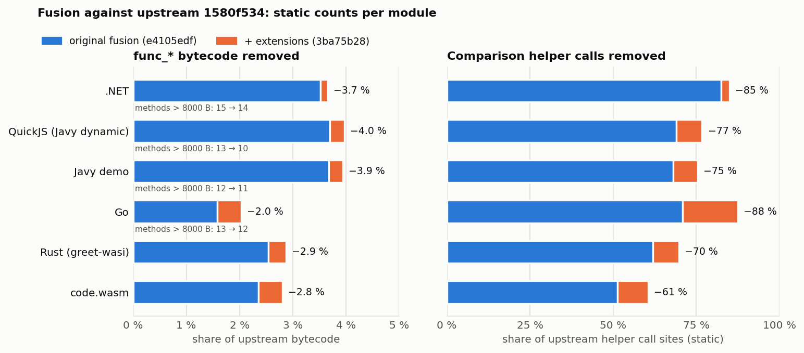
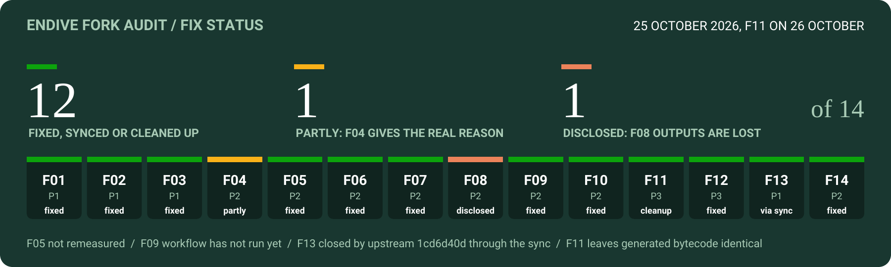

# Endive fork changes and benefits

**Current state, 2026-10-26.** `fuse-branch-conditions` is based on upstream
`main` `bce75ae6`, 23 October 2026 ([upstream-sync-2026-10-25.md](compiler/docs/upstream-sync-2026-10-25.md)).
The fork audit of 25 October ([FORK_AUDIT_2026-10-25.md](FORK_AUDIT_2026-10-25.md)) found two
fork regressions (a `ref.eq` fusion wrong result through loop parameters, and cache keys that
broke `DirectoryCache`) and several inherited defects; section 11 lists the fixes and the
validation of the result. Nothing after the sync is pushed: `origin/fuse-branch-conditions` still
points at the pre-sync `44f68a6f`.

**Commit ids.** The sync rebased every fork commit. This document names the commits on the
current branch and gives the pre-sync id once in parentheses ("was …"), because notes, results
and thesis records written before 25 October cite those; they stay reachable through the tag
`archive/fuse-branch-conditions-pre-sync-2026-10-25`, and the sync note maps all of them.
Measured statements keep the id that was measured.

**Scope and dates.** First written 2026-10-02, updated 2026-10-17 for the fusion extensions,
2026-10-18 for the improvement plan ([FORK_IMPROVEMENT_PLAN.md](FORK_IMPROVEMENT_PLAN.md),
section 10) and 2026-10-25 for the audit (section 11). It covers the fork-specific work in this
repository: the compiler changes on `fuse-branch-conditions`, earlier contributions accepted
upstream, and work kept on separate branches or in plans. Sections 1–10 are as of their dates;
sections marked historical are superseded.

## Overview

| Change | What it does | Main benefit | Status |
|---|---|---|---|
| Numeric comparison/branch fusion | Emits native JVM comparisons directly at the consuming branch or select | Less bytecode and fewer helper calls | Current branch, `444198a8` (was `f5225324`) |
| Fusion extensions | Constant-operand, unsigned `i64`, Go `i64`-boolean, and reference null-test conditions | Together with the original fusion: 2.0–4.0 % less function bytecode and 70–88 % fewer comparison helper calls than upstream on the five large modules. The extensions alone add 0.1–0.5 % bytecode and remove 15–57 % of the remaining helper calls | Current branch, `39f47cb9` (was `5a02a7dd`); upstream PR branch `pr/fuse-branch-conditions` |
| Large-parameter ABI repair | Preserves locals, numeric arguments, references, and indirect-call targets across boxed calls | Fixes verification failures, invalid descriptors, and silent wrong results | Current branch, `9a8136b5` (was `b4d973e1`) |
| Strict-build repair | Justifies the compilation-local use of enum ordinals | Restores the normal Error Prone build | Current branch, `3b29285b` (was `854e77ca`) |
| Compact branch-table dispatch | Chooses a smaller JVM switch encoding unless `tableswitch` is faster at ≤ 512 extra bytes (2026-10-25), and handles default-only tables | Reduces large method sizes and dispatch overhead in the measured synthetic case | Current branch, `0fe9b7f3` (was `82f39301`); policy `744036e2` |
| Wide multivalue return repair | Packs results inline when a packing helper would exceed the JVM parameter limit | Compiles valid wide result tuples | Current branch, `0fe9b7f3` |
| Splitter fixtures and diagnostics | Exercises actual tuple/mailbox outputs and records reproducible local evidence | Detects ABI regressions and supports measured optimization decisions | Current branch, `0fe9b7f3` |
| Signed and unambiguous block types | Decodes `s33` and distinguishes empty, value-type, and type-index forms | Correctly accepts valid multivalue modules and rejects malformed encodings | Included through upstream `4892e774` |
| Android-compatible block-type corpus | Uses the compatible three-argument stream write API | Allows the regression corpus to run on older Android versions | Included through upstream `4892e774` |
| Shared LEB128 reader | Consolidates three integer decoding loops | Simpler format validation and maintenance | Separate branch, `59392150` |
| Narrowing peephole, inline trivial helpers | `i64` work wrapped back to `i32` done in `i32`; one-instruction helpers emitted inline or as JDK intrinsics | Go −4.6 % bytecode, 16,615 → 585 extend helper calls | Current branch, `4dcb4424` (was `17542744`) |
| Sound reference types, `ref.eq` fusion | `select_t`, scope exits and (since 2026-10-25) loop parameters typed soundly; `ref.eq` as `if_acmpeq` when one side cannot be `i31ref` | Correct static types; fewer `refEq` calls in GC code | Current branch, `4537a111` (was `50a7c320`); loop fix `a7bc2db4` (section 11) |
| Opt-in unsigned `i32` fusion, branchless booleans | `Integer.compareUnsigned` + jump (on where the JVM allows), call-free value booleans (off) | Unsigned helper calls −70 to −99 %; 2× on a large generated method | Current branch, `801eb72f` (was `9e613f66`) |
| Incremental analyzer passes | Narrowing and fusion run while the instruction list is built | Halves the cold-JVM compile overhead | Current branch, `15cf06c2` (was `fa661588`) |
| `-Dendive.memCopyWorkaround` NPE fix | The workaround class honours the property; `gt_u`/`le_u` covered too | No NPE on Java 18+ with the property | Merged from `fix/memcopy-workaround-property` (`5cba8930`) |
| Build sharp edges | Versioned wasm-tools download, approval file rendered every run, Spotless fix | No stale-binary failures | Merged from `fix/build-sharp-edges` (`f2c7de7c`) |
| Audit fixes, 2026-10-25 | Versioned cache keys, interruption on tail calls, validator accepts `none` for abstract GC types, blocking fork CI, sharper evidence tooling | `DirectoryCache` works under the defaults again; tail-call loops can be cancelled; valid GC modules accepted | Current branch, `a7bc2db4`..`8b4becfd`; section 11 |

## 1. Numeric comparison and branch fusion

Previously, a comparison such as `i32.lt_s` called an `OpcodeImpl` helper that produced a `0/1`
integer. The immediately following `if`, `br_if`, or `select` tested that integer again. For
example, an `i32` comparison followed by a branch emitted an `invokestatic` and then an
`ifne`; it now emits the corresponding `if_icmp*` instruction directly.

`WasmAnalyzer.fuseBranchConditions` recognizes adjacent producers and consumers and emits
`COND_JUMP` or `SELECT_COND`. It handles signed `i32`/`i64` comparisons, `i64.eqz`, floating-point
comparisons, and chains of `i32.eqz` by reversing the branch sense. Floating-point emission
preserves the outcomes for NaN, including `ne`, and loop back edges retain interruption checks.
Explicit labels prevent fusion across a control-flow entry point.

Commit `39f47cb9` (was `5a02a7dd`) extends the pass ([branch-condition-fusion-extensions.md](compiler/docs/branch-condition-fusion-extensions.md)):
`i32` comparisons against 0, 1 or -1 become one-operand zero tests; unsigned `i32` comparisons
against a power-of-two bound become a shift and a zero test; unsigned `i64` comparisons jump on
`Long.compareUnsigned`; `i64.eqz (i64.extend_i32_u b)` (Go's boolean negation) is absorbed like
`i32.eqz`; `ref.is_null`, `br_on_null`, and `br_on_non_null` become `ifnull`/`ifnonnull`; and
`br_on_cast_fail` no longer inverts its cast result through extra branches. In this commit,
unsigned `i32` comparisons with variable or other constant operands keep their helper and
workaround paths, because fusing them needs the `MIN_VALUE` bias that C2 on Java 11 to 17
miscompiles (JDK-8376400). `801eb72f` later fuses them through `Integer.compareUnsigned` as an
option, on by default only in `MachineFactoryCompiler` on Java 18+ (section 10, item 3.4).

**Benefits.** The generated method no longer contains the comparison helper call or the
intermediate boolean at a fused site. A simple `i32` comparison/branch pair commonly saves
three method bytes; binary `i64` and floating-point comparisons commonly save two. This also
removes a real helper call when the generated method executes without that call being JIT
inlined. Smaller methods provide more headroom for compilation and inlining near JVM size
budgets. Already optimized small methods may have little runtime benefit because the JVM can
eliminate the original helper call itself.

**Relevance to function splitting.** Outlined helpers contain comparisons for routing, loop
control, and ordinary Wasm work. Fusion reduces those methods' own bytecode and their demand
for helper inlining. It complements splitting; it does not change the splitter's ABI.

The existing differential and structural tests cover branch/select forms, stack unwinding,
loop back edges, signed limits, zero, infinities, and NaN. See
[branch-condition-fusion.md](compiler/docs/branch-condition-fusion.md) for the original design
and [branch-condition-fusion-jit-audit.md](compiler/docs/branch-condition-fusion-jit-audit.md)
for the historical JIT/workaround audit. The local workload A/B of the whole fork (section 10)
is faster in 29 of 37 real cells; a fixed-runner speedup of fusion alone has not been established.

**Measured size effect (static).** Against upstream main `1580f534`, the original fusion plus the
extensions reduce total `func_*` bytecode by 3.66 % (.NET), 3.97 % (QuickJS), 3.94 % (Javy
demo), 2.04 % (Go), 2.87 % (Rust), and 2.80 % (`code.wasm`). Methods above HotSpot's
8000-byte `HugeMethodLimit` drop from 15 to 14 (.NET), 13 to 10 (QuickJS), 12 to 11 (Javy),
and 13 to 12 (Go). Endive comparison and null-test helper calls drop by 70–88 % on the five
large modules and by 61 % on the small `code.wasm` (the JDK `Long.compareUnsigned` calls that
replace unsigned `i64` helpers are counted separately). Raw data and `plot.py`:
[data/branch-condition-fusion-2026-10-17/](compiler/docs/data/branch-condition-fusion-2026-10-17/).

**Measured runtime effect (local, exploratory).** Upstream main and the PR branch were timed on
identical modules with the thesis harness: fresh JVM per sample, interleaved rounds, paired
bootstrap CI ([branch-condition-fusion-benchmarks.md](compiler/docs/branch-condition-fusion-benchmarks.md)).
Steady state was 4–10 % faster wherever the hot code is compiled: Lua −5.5 %, Lua split −4.1 %,
SQLite 8 kB split −9.5 %, QuickJS 8 kB split −6.4 %. Unsplit SQLite and QuickJS, whose hot
function above 64 KB falls back to the interpreter, were neutral, and runtime compilation was up
to 2.5 % slower. Endive's JMH suite showed no effect. So fusion complements splitting: it
speeds up the compiled methods that splitting creates. These are single-session laptop
results, not fixed-runner evidence.

## 2. Large-parameter ABI repair

JVM descriptors have a parameter-slot limit; `i64` and `f64` use two slots. Endive passes
ordinary parameters directly, but switches wide signatures to arrays. Commit `9a8136b5`
(was `b4d973e1`) repairs several connected problems in this path:

| Previous failure | Implemented repair | Benefit |
|---|---|---|
| The boxed callee mixed Wasm local indices with JVM parameter counts and missed local initialization | Initialize all declared locals using Wasm parameter/local bounds | Reads before a write receive Wasm's zero/null defaults; generated classes verify |
| GC references and `externref` parameters were replaced with null | Add an `Object[]` alongside `long[]` when object references are present, and forward it through callers and bridges | Preserves reference identity and avoids silent wrong values or null-reference traps |
| Indirect-call stubs added four parameters to signatures that allowed 253 Wasm slots | Use a consistent boxing threshold above 251 Wasm parameter slots | All generated direct/indirect/ref-call descriptors fit the parameter limit |
| Boxing included or overwrote the indirect table selector or saved function reference | Keep the call target in a temporary slot above the arguments | Dispatches to the intended function with intact arguments |
| Chunked indirect dispatch loaded parameters by argument index | Load according to JVM slot widths and boxed-signature layout | Correctly handles `i64`, `f64`, and boxed signatures in large dispatch groups |

The reference channel is propagated through exported entry points, direct calls, `call_indirect`,
`call_ref`, host imports, cross-module bridges, and interpreter fallback. Smaller signatures
retain direct parameter passing. Moving the threshold from 253 to 251 also moves those two slot
counts onto the array path; this is a correctness tradeoff, not a measured speed optimization.

**Relevance to function splitting.** Helpers receive live-ins as parameters, so wide boundaries
must preserve both values and freshly declared locals. The repair also makes original wide
functions and bridge types usable independently of splitting. It does not imply that typical
small helper signatures became faster.

[ManyParamsAbiTest.java](machine-tests/src/test/java/run/endive/testing/ManyParamsAbiTest.java)
covers default locals, non-null GC/host references, slots 251–254, mixed-width arguments,
chunked dispatch, and cross-module calls across interpreter, compiler, and selected fallback
configurations. [many-params-abi-bugs.md](compiler/docs/many-params-abi-bugs.md) is the earlier
pre-fix investigation; its 253-slot threshold and open-bug statements describe that revision.
The separate `fix/many-params-abi` branch carries a standalone version of the repair on
upstream `1580f534` as `43786182` (the `9e257558` cited in older notes is no longer on any ref).

## 3. Strict-build repair

Commit `3b29285b` (was `854e77ca`) adds a narrowly scoped `EnumOrdinal` suppression to `BranchCondition.id()`.
The integer is an internal operand used and decoded within one compilation, so declaration
order is intentional and is not a persisted external identifier.

**Benefit.** Comparison fusion builds with the project's normal Error Prone warning policy.
This changes build acceptance, with no runtime performance claim. The earlier audit's warning
failure is resolved on the current branch.

## 4. Compact branch-table dispatch

The compiler previously emitted `tableswitch` for every Wasm `br_table`. A table can have
thousands of entries but only a few exceptional targets, making that encoding unnecessarily
large. The new [SwitchEmitter.java](compiler/src/main/java/run/endive/compiler/internal/SwitchEmitter.java)
compares switch encoding sizes and:

- Omits lookup keys whose target equals the default.
- For tables with at least 8,000 encoded bytes, considers the most frequent target as an
  alternate lookup default. Explicit negative and upper-bound checks retain the original Wasm
  out-of-range destination.
- Keeps `tableswitch` when it is smaller, including small tables where added bounds checks had
  no established performance benefit.
- Emits a selector pop and jump when every explicit entry already equals the default, including
  a valid `br_table` with no explicit entries.

Backward-edge interruption checks remain in the compiler, outside the encoding choice.

**Measured benefits.** In the pinned CPython module, `_PyUnicode_ToNumeric_3281` shrank from
**65,469 to 47,793 bytes**, a **27% reduction**. Its baseline and final generated methods
returned identical double bit patterns for all 1,114,112 Unicode code points and six additional
selectors. The method remains above the splitting JIT target, and the module still has two
interpreter-fallback functions.

A synthetic 4,096-entry dispatch with three rare cases measured **136.22 ns/op** for the
baseline and **30.63 ns/op** for the final compiler, with about **24 B/op** allocated in both.
These are sequential local JMH trials with two forks per compiler. Host drift and run order
are outside their confidence intervals; they establish an exploratory result for this case,
not a general CPython or split-workload speedup.

**Measured cost (2026-10-18).** Choosing by size alone can slow dispatch. In the synthetic
`rustvm` workload, `exec_op` (16.6 kB, interpreted by HotSpot) has a 160-entry table with 70
explicit keys. It now gets a `lookupswitch`, which saves 84 bytes, but HotSpot's interpreter
executes it as a binary search.
The whole run is 12.6 % slower than upstream; forcing `tableswitch` removes the slowdown.
Bisected to this change (pre-sync `82f39301`, now `0fe9b7f3`); see
[workload-ab-2026-10-18.md](compiler/docs/workload-ab-2026-10-18.md).

The rule needed a speed-aware threshold before it could be offered upstream; see the policy below.

**Policy since 2026-10-25.** A table keeps `tableswitch` when javac's time/space rule prefers it
and the lookup would save at most 512 bytes; otherwise the smaller encoding wins as before. On
CPython, `_PyUnicode_ToNumeric_3281` stays at 47,793 bytes (47,789 with the current analyzer); the
module grows by 0.09 %, no method crosses 8000 bytes, and the fallbacks stay at two. rustvm's
`exec_op` gets the `tableswitch` of the bisection's forced-`tableswitch` build back.
Remeasured 2026-10-26 (`c5219baf` against upstream `bce75ae6`, 12 rounds, Java 21): `rustvm-base`
+1.6 % [−2.0, +3.3], `z80-base` +0.8 % [−0.6, +3.4], neither significant, against +12.6 %
[+9.9, +14.8] before ([data/switch-policy-2026-10-26/](compiler/docs/data/switch-policy-2026-10-26/)).

**Relevance to function splitting.** Smaller dispatch code can reduce the size of parents and
helpers, provide headroom for other instructions, and reduce pressure to split further. The
Endive size oracle and compiled artifacts should be rebuilt before retuning the Binaryen size
model or splitting budgets, since old switch costs no longer describe all emitted methods.

## 5. Wide multivalue return repair

Multivalue returns normally call a generated `value_xxx` packing method. A valid result tuple
of one `i32` and 128 `i64` values would give that helper **257 parameter slots**. The baseline
failed with `IllegalArgumentException: bad parameter count 257` before the module could run.

The compiler now skips that packing-helper signature when results exceed 255 slots and packs
the values inline through reserved temporary locals. Numeric results retain the existing
`long[]` representation; mixed object/numeric results retain `Object[]` with numeric values
converted as before. Smaller tuples keep their existing helper.

**Benefit.** Valid wide tuples compile and preserve their values without exceeding the packing
method's descriptor limit. This is a correctness and compatibility repair; it does not claim
an allocation reduction. Ordinary JVM method-size and local-slot limits still apply.

**Relevance to function splitting.** A tuple boundary can return a route code plus live-outs.
If that boundary becomes wide, the packing helper must remain valid even though the Wasm
function itself has few parameters. Tests cover the 255-slot boundary and larger numeric and
reference tuples.

## 6. Splitter fixtures, benchmarks, and evidence

`0fe9b7f3` adds ten focused tests in
[SplitFunctionOptimizationTest.java](compiler-tests/src/test/java/run/endive/testing/SplitFunctionOptimizationTest.java),
and the 2026-10-25 switch policy (`744036e2`) two more.
They check switch encodings and selector bounds, interruption, tuple values and shared returns,
fallback, host numeric normalization, GC results, exception paths, tail calls, and wide results.

Two fixtures come from the actual experimental Binaryen function-splitting pass. A
three-function source produces six functions with the tuple ABI and seventeen with routed
globals. Their self-checks exercise both routes and recursive re-entry; compiler and interpreter
results agree, and both modules compile without fallback.

[regenerate-split-function-fixtures.sh](scripts/regenerate-split-function-fixtures.sh) reproduces
the fixtures using the Binaryen executable's matching shared library. Tool, library, source,
and output pins are saved with the local evidence. Final regeneration reproduced all three
Wasm fixture files byte for byte.

[BenchmarkSplitFunctionBoundaries.java](jmh/src/main/java/run/endive/bench/BenchmarkSplitFunctionBoundaries.java)
provides synthetic tuple-chain and sparse-dispatch cases. Saved raw measurements and standalone
bytecode/specification comparison utilities make the decisions reviewable and repeatable.
Their benefit is better regression detection and measurement discipline; they are not
themselves a production execution optimization.

## 7. Earlier parser work incorporated upstream

### Signed block-type decoding and distinct operand forms

Earlier fork revisions `cd104dd8`, `94cd7858`, and `40d1643e` developed the block-type fix.
The accepted implementation is in upstream commit `4892e774` (#136), an ancestor of this branch.

The parser reads block types as bounded signed `s33` encodings and uses `BlockType` to tag
three distinct forms: empty, inline value type, and type-section index. The parser, validator,
interpreter, JVM analyzer, and Redline native compiler consume those forms consistently.

**Benefits.** Padded valid encodings decode correctly; malformed length/range/sign encodings
are rejected; and valid type indices that overlap raw value-type opcodes are no longer confused
with value types. The generated corpus covers indices 63–128. This is particularly relevant
when splitting introduces multivalue block signatures into a module with many function types.

### Android-compatible regression corpus

Commit `ddb83bff`, also incorporated in `4892e774`, changes the block-type corpus generator
from `ByteArrayOutputStream.writeBytes` to `write(bytes, 0, bytes.length)`.

**Benefit.** The same regression module can be constructed on older Android runtimes that
lack `writeBytes`, avoiding the previously reported API-28 `NoSuchMethodError`. This changes
test portability and keeps the generated bytes equivalent. The current optimization validation
was local JVM validation; it did not run Android device tests.

## 8. Separate-branch work and deferred experiments

### Shared LEB128 reader — separate branch

Commit `59392150` on `fix/leb128-spec-reader` consolidates unsigned-32, signed-32, and signed-64
integer decoding into `readLeb128(buffer, bits, signed)`. It checks the remaining payload-bit
budget and continuation limits in one place, retains permitted padded encodings, and removes
the old duplicate helpers and constants.

**Benefit.** The format rules become easier to review and maintain. No decoding-speed benefit
has been established here. The active branch still uses the existing separate integer readers;
the accepted block-type fix has its own `s33` reader.

### Tuple call/return forwarding — evaluated and excluded

A prototype returned a compiled helper's result array directly from its caller instead of
unpacking and repacking it. Correctness checks passed and emitted marshalling code decreased.
However, HotSpot already eliminated intermediate arrays in the synthetic chains: allocation
stayed at 32, 80, and 272 B/op for 2, 8, and 32 results. Timing was noisy, and the 32-result
A/B/A confidence intervals overlapped.

The final compiler excludes this prototype. Its prospective benefit is smaller boundary code,
but a runtime or allocation benefit needs evidence from actual split helper bodies and JVM
inlining behavior before implementation is justified.

### Reference-condition fusion — null tests implemented, `ref.eq` deferred (historical, 2026-10-17)

*Superseded:* `ref.eq` fusion was implemented in `4537a111` (was `50a7c320`; section 10,
item 3.3) after sound `select_t` and scope-exit typing; the remaining unsound case, loop
parameters, was fixed on 2026-10-25 in `a7bc2db4` (section 11).

[ref-condition-fusion-plan.md](compiler/docs/ref-condition-fusion-plan.md) proposed direct null
branches for `ref.is_null`, `br_on_null`, and `br_on_non_null`, followed by carefully gated
`ref.eq` fusion. The null tests are implemented in `39f47cb9` (with a simpler design than the
plan: a generic `DUP` opcode plus ordinary `BranchCondition`s). `ref.eq` remains deferred:
`i31ref` equality is value-based, and the analyzer currently types `select`/`select_t` results
by their second operand, so static types cannot yet prove an operand non-i31.

## 9. Validation and practical limits (2026-10-02 snapshot)

*Historical:* the counts below are those of the 2026-10-02 snapshot. Current validation is at
the end of section 11.

The final optimization compiler passed **41 compiler unit tests and 28 compiler-tests tests**
on both the classpath and module path, plus **1,051 selected specification cases**. The
specification run used existing generated inputs compiled afresh. The large-class suite also
passed earlier with its existing disabled case; it was excluded from the final repeat.
Formatting, Checkstyle, Error Prone, dependency analysis, JMH compilation, shell syntax, and
diff whitespace checks passed.

The full dependency rebuild stopping in bundled `wasm-tools` (function 4725 exceeding the JVM
method-size limit) was caused by a stale `wasm-tools/target/wasm-tools.wasm` from Oct 2025 that
the build never re-downloads; upstream main fails identically with that file. With a fresh
download of the pinned wasm-tools 1.256.0, the fork branch, the upstream PR branch, and upstream
main all build `wasm-tools` (verified 2026-10-17). Module validation used available dependency
artifacts. The pure CPython
numeric comparison does not validate the complete CPython WASI program. These measurements
remain local diagnostics; no fixed-runner thesis performance acceptance is claimed.

The earlier design/audit notes are included as historical context and retain their original
revision-specific findings. Current implementation status is summarized above. Full commands,
raw results, pins, and remaining opportunities are in
[split-function-optimization-results.md](compiler/docs/split-function-optimization-results.md);
the implementation sequence is in
[split-function-optimization-plan.md](compiler/docs/split-function-optimization-plan.md).

## 10. Improvement plan, 2026-10-18

Implemented from [FORK_IMPROVEMENT_PLAN.md](FORK_IMPROVEMENT_PLAN.md); details per item:

| plan item | what | where |
| --- | --- | --- |
| 0.1 | Fork builds use their own Maven repository (`scripts/mvn-fork.sh`); the thesis harness stamps the installed Endive and records it in every results file | `scripts/mvn-fork.sh`; thesis repo `tools/endive_stamp.py` |
| 0.2 | Topic branches pushed to the fork; integration branch merged upstream main `1580f534` | [upstream-pr/OPEN_PRS.md](compiler/docs/upstream-pr/OPEN_PRS.md) |
| 1.1–1.4 | Engine decision (vendored Endive for the thesis), fork oracle, fork size model, fixed-runner A/B campaign | thesis repo `docs/CLAIMS.md`, `docs/reports/ENDIVE_FORK_TRACK.md`, `ci/run_endive_fork_ab.sh` |
| 2.x, 4 | PR branches rebased, tested (also on Java 11), described; not opened (policy: a human opens them) | [upstream-pr/OPEN_PRS.md](compiler/docs/upstream-pr/OPEN_PRS.md) |
| 3.1 | Narrowing peephole and inline helpers | [narrowing-and-trivial-helpers.md](compiler/docs/narrowing-and-trivial-helpers.md) |
| 3.2, 3.4 | Branchless booleans (off), unsigned `i32` fusion (opt-in, automatic in `MachineFactoryCompiler` on Java 18+) | [opt-in-comparison-lowerings.md](compiler/docs/opt-in-comparison-lowerings.md) |
| 3.3 | Sound `select_t`/scope types, `ref.eq` fusion | [ref-eq-fusion.md](compiler/docs/ref-eq-fusion.md) |
| 3.5 | `BenchmarkLargeMethod` | [large-method-benchmark.md](compiler/docs/large-method-benchmark.md) |
| 3.6 | Runtime-compile regression: cold-JVM cost of the post-passes, halved | [compile-time-regression.md](compiler/docs/compile-time-regression.md) |
| 3.7 | C2 refuses 97 % of helper calls near 8000 bytes upstream | [inlining-at-8000-bytes.md](compiler/docs/inlining-at-8000-bytes.md) |
| — | Fork against upstream on 37 real workload cells: faster in 29 (median −6.7 %), none slower, outputs identical; compile +2–5 % (unsplit QuickJS +14–22 %). Synthetic `rustvm-base`: +12.6 % from the compact switch encoding, removed by the 2026-10-25 switch policy (+1.6 % [−2.0, +3.3] on 2026-10-26) | [workload-ab-2026-10-18.md](compiler/docs/workload-ab-2026-10-18.md) |

All runtime numbers in these notes are laptop measurements; the thesis cites fork speed only
from the fixed-runner campaign.

## 11. Audit fixes, 2026-10-25

From [FORK_AUDIT_2026-10-25.md](FORK_AUDIT_2026-10-25.md) (section 9 there has the per-fix
evidence), on the branch rebased onto upstream `bce75ae6`, which itself closes F13
(table-initialiser entries ran in the importing instance; upstream `1cd6d40d`).

| finding | fix | commit |
| --- | --- | --- |
| F01, fork | Loop parameters get their declared types on entry, so a struct on first entry and an `i31ref` on the back edge no longer let `ref.eq` fuse into `if_acmpeq` | `a7bc2db4` |
| F02, fork | Cache key `endive-codegen-v1:` + padded Base64 SHA-256 of module digest and code generation settings; `DirectoryCache` works under the defaults again | `61eaad20` |
| F03, inherited | Interruption polled on every tail call (compiled `setTailCall*`, interpreter `RETURN_CALL`) | `55c485c7` |
| F04, inherited | Compiled cross-instance `return_call_indirect` names the real reason; support itself still open | `03c8d491` |
| F05, fork | `tableswitch` kept where faster at ≤ 512 extra bytes (section 4); remeasured 2026-10-26: `rustvm-base` +1.6 % [−2.0, +3.3], was +12.6 % | `744036e2` |
| F06, F07, fork | Workload A/B reducers validate cells and compare outputs strictly; all 37 estimates unchanged | `23b9ae08` |
| F08, fork | Disclosed, not recoverable: the archive keeps round 1 outputs only; the summary says "2 of 24" and the workload notes say where the full check ran | `5f7b6030` |
| F09, inherited | Blocking `Fork CI` workflow (Java 11/17/21/25) on the integration and topic branches; no live run yet | `af5de0d3` |
| F10, fork | `mvn-fork.sh` rejects every repository override spelling; `AGENT.md` points at it | `3219c546` |
| F11, mixed | Value-array boxing/spill helpers, one numeric-comparison set, explicit type-stack scope invariants; generated bytecode identical | `c6aaaac2`, `24e05619`, `8b4becfd` |
| F12, fork | Status header, historical labels, this section | `5f7b6030`, `c5219baf` |
| F14, inherited | Validator accepts `(ref null none)` where `eqref`, `structref`, `arrayref`, `i31ref` is expected | `a85542e0` |

Not changed: cross-instance tail calls themselves (F04). F11's refactoring is kept in commits of
its own after the semantic fixes; 537 module × option rows hash identical before and after.
F01, F03, F04, F14 and the upstream-side part of F09 are upstream-relevant; F03 and F14 are
inherited fixes worth offering upstream.

**Validation.** Strict build (Error Prone, Checkstyle, Spotless) after F11, with
`-pl compiler-tests,machine-tests,dircache -am`: compiler unit 66, compiler specification suite
34,123 (64 skips), `machine-tests` 265, runtime 98, `DirectoryCacheTest` 4; no failures or errors.
Before F11, the same build with `runtime-tests` also ran the interpreter specification suite,
62,246 (83 skips), without failures.

**Java 17 and 27 (2026-10-26).** The same `-pl compiler-tests,machine-tests,dircache -am` build
on `c5219baf` passes on Temurin 17.0.21 and 27.0.1 with the same counts, and on 17.0.21 also with
unsigned compare fusion forced on. OpenJDK's JDK-8376400 reproducer still fails on 17.0.21 (no
17u backport), so the Java 17 defaults stay. A workload A/B on both JDKs (six cells, ten rounds)
has the fork faster than upstream in every cell: −5.1 to −10.8 % on Java 17 with the workaround
on, −4.3 to −14.6 % on Java 27; the workaround itself costs −0.8 to +1.4 %. Details in
[jdk17-jdk27-validation-2026-10-26.md](compiler/docs/jdk17-jdk27-validation-2026-10-26.md).
Java 11 and 25 are left to the `Fork CI` workflow, which has not run yet.
