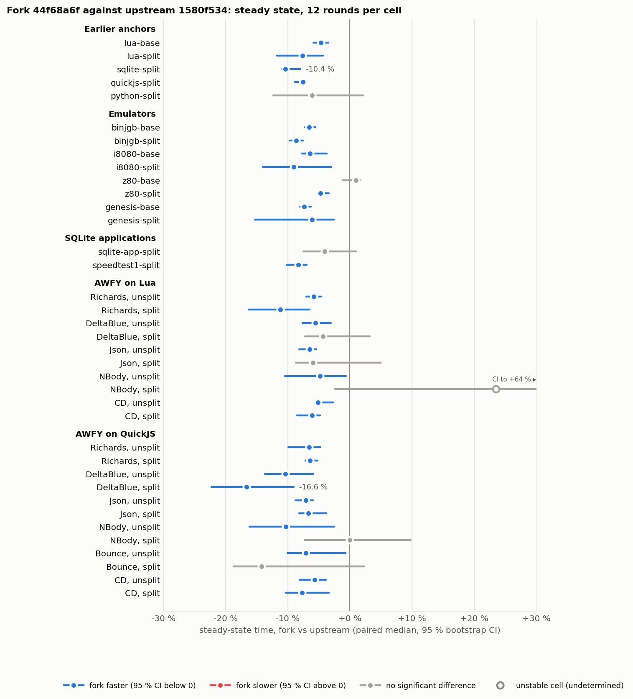
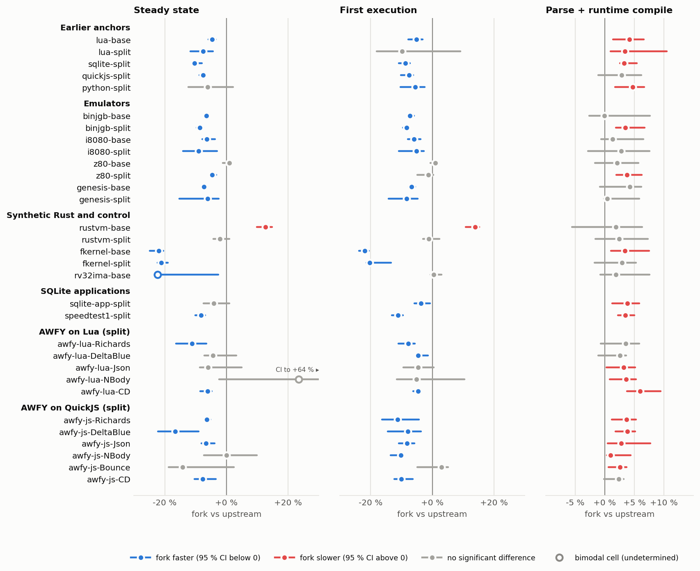
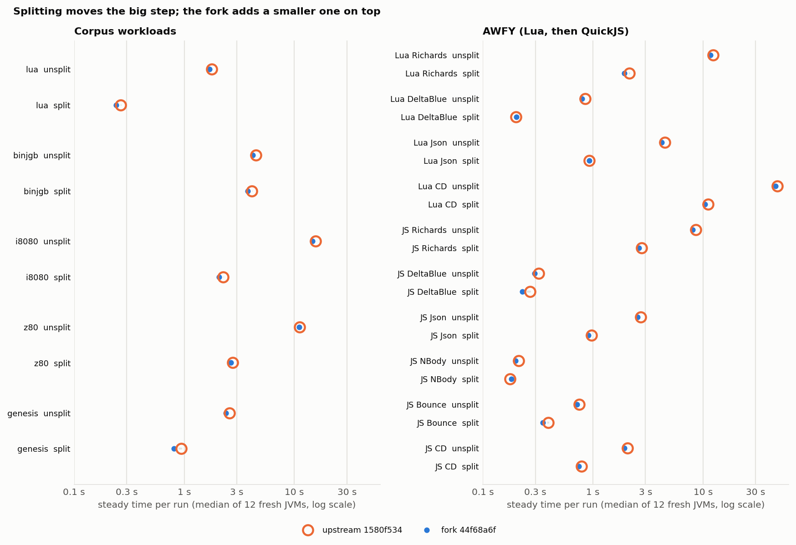
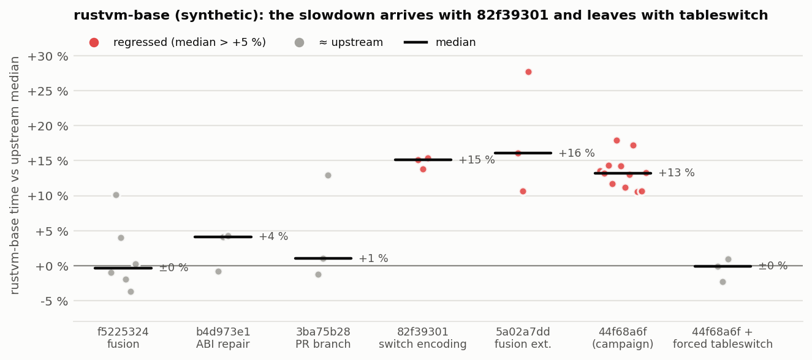

# Fork against upstream on 37 workload cells (local)

Run: 2026-10-18 21:45 to 2026-10-19 00:22 local time, plus the unsplit AWFY cells on 2026-10-19
07:07–08:36. Both were single laptop sessions, so treat
the numbers as exploratory timing evidence, not fixed-runner thesis evidence.
It extends [branch-condition-fusion-benchmarks.md](branch-condition-fusion-benchmarks.md), which
compared only the fusion PR branch on three workloads. Here the arm is the **whole fork**, and the
workload set is taken from the thesis repository (`gitlab/experimental`, `c804f164b`).
Raw data and scripts: [data/workload-ab-2026-10-18/](data/workload-ab-2026-10-18/).

| arm | Endive revision | compiler jar sha256 |
| --- | --- | --- |
| **up** | `bytecodealliance/endive` main `1580f534` (still upstream main on 2026-10-18) | `6101f7741503…` |
| **fork** | `fuse-branch-conditions` `44f68a6f` (engine code = `7e743d80`) | `9dfba22650ea…` |

Each arm was built in its own worktree with
`./mvnw package -Dquickly -Dspotless.skip=true -pl compiler,wasi -am` against the fork's own
Maven repository. Neither arm was installed anywhere. Each runs from its own `target/*.jar` files
plus ASM 9.10.1. The fork's compiler jar is the one the thesis report
`FORK1_FORK_ORACLE_AND_MODEL.md` records for `7e743d80`.

## Summary

- **The fork is faster in 29 of 37 cells by steady state** (paired 95 % CI excludes 0), median
  **−6.7 %**, range −4.7 to −16.6 %. The other eight cells are not significant; seven of them have
  a median below zero. **No cell is significantly slower.**
- **AWFY on the unsplit interpreters improves in all 11 cells**: Lua −4.8 to −6.4 %, QuickJS
  −5.7 to −10.4 %. So the gain does not depend on splitting.
- **Guest output is identical** across both arms and all 24 samples of every cell, with
  timing numbers masked. That check ran in the bench directory; this data directory keeps round 1
  of each arm, so only 2 of the 24 outputs per cell can be rechecked from it (see Limitations).
- **Runtime compilation is slower**: +2 to +5 % (10–90 ms) on most modules, significant in 23 of
  37 cells. This is the cold-JVM cost described in
  [compile-time-regression.md](compile-time-regression.md); the incremental passes reduced it but
  did not remove it. **Unsplit QuickJS is the outlier at +14 to +22 % (165–315 ms)**; that module
  has 11 methods over 8000 bytes, the largest 55.9 kB. Not investigated yet.
- The three workloads of the earlier PR-only run reproduce, and the full fork goes slightly further:
  Lua split −7.6 % (PR: −4.1 %), SQLite split −10.4 % (−9.5 %), QuickJS split −7.5 % (−6.4 %),
  Lua base −4.7 % (−5.5 %).
- **Synthetic workloads excluded.** The thesis corpus also has two synthetic Rust kernels (rustvm,
  fkernel) and a synthetic RISC-V payload (rv32ima). They were measured but are left out of the
  tables, figures and counts above. Their data is in `results-excluded/`. One of them,
  `rustvm-base`, exposed a 12.6 % slowdown from the compact switch encoding, which is a real
  compiler issue; it is kept in its own section
  ([below](#synthetic-case-rustvm-base-and-lookupswitch)).



## Setup

**Machine:** AMD Ryzen 7 7840HS, Linux 7.2.10, OpenJDK 21.0.12.1 (`/usr/bin/java`), `ondemand`
governor with boost on (no root to change it). The desktop session was running (Firefox, Baloo).
Every measurement JVM was pinned with `taskset -c 4-7`.

**Protocol:** as in the fusion benchmarks. Each sample is a fresh JVM running the thesis
`EndiveRun.java` (WASI on `MachineFactoryCompiler`): parse, runtime compile, then
`warmup` + `reps` runs of `_start`. Both arms run in a seeded random order within each round
(`BENCH_ORDER=permuted`, seed `20261018`), with **12 rounds per cell**. The verdict is the
median of the paired per-round ratios fork/up, with a bootstrap 95 % CI (10,000 resamples).
Metrics: `exec_ms_median` (steady), `first_exec_ms`, and `compile_ms` (parse + runtime compile).
`campaign.sh` holds the full workload table: module, warmup/reps and guest arguments.

**Modules.** Both arms run identical bytes (`campaign_modules.sha256`). This compares engines,
not split against unsplit.

| group | cells | source of the module |
| --- | --- | --- |
| earlier anchors | lua base/split, sqlite split, quickjs split, python split | thesis `results/2026-10-17/fork-fusion-ab/splits` (pinned) and the tracked corpus |
| emulators | binjgb, i8080, z80, genesis (base and 8 kB split) | tracked corpus; splits made with `run_corpus_split_matrix.sh prepare` (canonical endive-throughput recipe: 3-run Node edge profile, `jvm` metric, 8 kB, post-cleanup, `br_table` grouping). Gates: G1 output identical to pristine, G2 over-8 kB methods 3→1 / 1→0 / 2→1 / 8→3 (`split-prepare.log`) |
| SQLite apps | `sqlite_app --mode inmem`, `speedtest1 --memdb --size 5 --testset mix1` | blanket split 8-64 with `br_table` grouping, no profile (the unsplit modules run `sqlite3_step` > 64 KB in Endive's interpreter: 33 s and 39 s per run, where fusion cannot act) |
| AWFY Lua | Richards, DeltaBlue, Json, NBody, CD on `lua_awfy_wasi.wasm`, unsplit (5 methods over 8000 bytes, largest 25.5 kB) and split; the split NBody cell runs 10× longer (see below) | blanket split 8-64-bt (as `run_awfy_lua_startup.sh`), AWFY sources mounted at `/awfy` |
| AWFY JS | Richards, DeltaBlue, Json, NBody, Bounce, CD on `qjs_awfy_wasi.wasm`, unsplit (11 methods over 8000 bytes, largest 55.9 kB, all under 64 KB) and split | blanket split 8-64-bt |

The split modules were sized by the thesis `wasm-opt` against the *vendored* Endive's costs.
Each unsplit AWFY cell uses the same guest arguments as its split cell. The slowest ones have
fewer in-process runs: Lua Richards 1 warmup + 2 measured runs, and Lua CD 1 + 1 (47 s per run).
The unsplit cells were added the next morning with the same builds, harness and seed
(`campaign-unsplit-awfy.log`).

## Results

Steady state is the median of the in-process repetitions. The tables for first execution and
compile time are in [data/workload-ab-2026-10-18/results/SUMMARY.md](data/workload-ab-2026-10-18/results/SUMMARY.md).

| workload | n | up ms | fork ms | Δ steady | 95 % CI | Δ first exec | Δ compile |
| --- | ---: | ---: | ---: | ---: | --- | ---: | ---: |
| lua-base | 12 | 1,787 | 1,702 | **−4.7 %** | [−5.9, −3.4] | −5.2 % | +4.1 % |
| lua-split | 12 | 265 | 240 | **−7.6 %** | [−11.7, −4.3] | −9.7 % n.s. | +3.4 % |
| sqlite-split | 12 | 1,905 | 1,720 | **−10.4 %** | [−11.0, −8.0] | −8.7 % | +3.3 % |
| quickjs-split | 12 | 8,615 | 7,974 | **−7.5 %** | [−8.8, −7.0] | −7.5 % | +2.9 % n.s. |
| python-split | 12 | 381 | 364 | −6.1 % | [−12.3, +2.2] | −5.6 % | +4.7 % |
| binjgb-base | 12 | 4,465 | 4,175 | **−6.5 %** | [−7.2, −5.6] | −7.2 % | −0.1 % n.s. |
| binjgb-split | 12 | 4,122 | 3,764 | **−8.6 %** | [−9.7, −7.5] | −8.3 % | +3.5 % |
| i8080-base | 12 | 15,584 | 14,544 | **−6.4 %** | [−7.8, −3.7] | −5.9 % | +1.3 % n.s. |
| i8080-split | 12 | 2,261 | 2,080 | **−9.0 %** | [−14.0, −3.0] | −5.1 % | +2.8 % n.s. |
| z80-base | 12 | 11,120 | 11,107 | +1.0 % | [−1.1, +1.7] | +1.0 % n.s. | +2.1 % n.s. |
| z80-split | 12 | 2,760 | 2,646 | **−4.7 %** | [−5.2, −3.4] | −1.2 % n.s. | +3.7 % |
| genesis-base | 12 | 2,573 | 2,387 | **−7.3 %** | [−8.1, −6.2] | −6.7 % | +4.3 % n.s. |
| genesis-split | 12 | 940 | 809 | **−6.1 %** | [−15.3, −2.6] | −8.4 % | +0.4 % n.s. |
| sqlite-app-split | 12 | 1,917 | 1,866 | −4.1 % | [−7.5, +1.0] | −3.7 % | +3.8 % |
| speedtest1-split | 12 | 2,533 | 2,309 | **−8.3 %** | [−10.1, −7.0] | −11.1 % | +3.5 % |
| awfy-lua-unsplit-Richards | 12 | 12,388 | 11,617 | **−5.8 %** | [−7.0, −4.7] | −6.0 % | −2.8 % n.s. |
| awfy-lua-split-Richards | 12 | 2,149 | 1,925 | **−11.2 %** | [−16.3, −6.4] | −7.7 % | +3.5 % n.s. |
| awfy-lua-unsplit-DeltaBlue | 12 | 850 | 799 | **−5.5 %** | [−7.6, −3.1] | −9.4 % | +4.7 % n.s. |
| awfy-lua-split-DeltaBlue | 12 | 201 | 202 | −4.3 % | [−7.2, +3.2] | −4.6 % | +2.6 % n.s. |
| awfy-lua-unsplit-Json | 12 | 4,490 | 4,207 | **−6.4 %** | [−8.2, −5.4] | −6.3 % | +8.2 % |
| awfy-lua-split-Json | 12 | 928 | 926 | −5.9 % | [−8.7, +5.0] | −4.6 % n.s. | +3.2 % |
| awfy-lua-unsplit-NBody | 12 | 313 | 302 | **−4.8 %** | [−10.5, −0.6] | −5.9 % n.s. | +4.4 % n.s. |
| awfy-lua-split-NBody-long | 12 | 564 | 543 | −3.5 % | [−5.1, +1.1] | +3.1 % n.s. | +6.0 % |
| awfy-lua-unsplit-CD | 12 | 47,309 | 45,491 | **−5.1 %** | [−5.5, −2.7] | −4.4 % | +1.3 % n.s. |
| awfy-lua-split-CD | 12 | 11,072 | 10,396 | **−6.1 %** | [−8.5, −4.8] | −4.6 % | +5.9 % |
| awfy-js-unsplit-Richards | 12 | 8,576 | 8,022 | **−6.5 %** | [−9.9, −4.7] | −7.0 % | +15.5 % |
| awfy-js-split-Richards | 12 | 2,766 | 2,603 | **−6.4 %** | [−7.1, −5.2] | −11.3 % | +3.7 % |
| awfy-js-unsplit-DeltaBlue | 12 | 321 | 295 | **−10.4 %** | [−13.7, −5.9] | −6.5 % | +14.8 % |
| awfy-js-split-DeltaBlue | 12 | 268 | 229 | **−16.6 %** | [−22.3, −9.0] | −7.9 % | +3.8 % |
| awfy-js-unsplit-Json | 12 | 2,713 | 2,534 | **−7.1 %** | [−8.8, −5.9] | −7.2 % | +13.5 % |
| awfy-js-split-Json | 12 | 968 | 909 | **−6.7 %** | [−8.2, −3.8] | −8.2 % | +2.8 % |
| awfy-js-unsplit-NBody | 12 | 211 | 199 | **−10.3 %** | [−16.1, −2.5] | −12.0 % | +14.3 % |
| awfy-js-split-NBody | 12 | 177 | 182 | −0.0 % | [−7.3, +9.8] | −10.2 % | +1.0 % |
| awfy-js-unsplit-Bounce | 12 | 754 | 714 | **−7.1 %** | [−10.0, −0.7] | −6.3 % | +21.6 % |
| awfy-js-split-Bounce | 12 | 395 | 350 | −14.2 % | [−18.7, +2.3] | +3.0 % n.s. | +2.6 % |
| awfy-js-unsplit-CD | 12 | 2,061 | 1,936 | **−5.7 %** | [−8.1, −3.8] | −5.6 % | +13.9 % |
| awfy-js-split-CD | 12 | 790 | 747 | **−7.7 %** | [−10.3, −3.4] | −10.1 % | +2.3 % n.s. |

Bold: the CI excludes 0. "n.s." in the first-exec and compile columns marks a CI that includes 0;
the other entries in those columns are significant.





The second figure shows the order of effects. Splitting cuts the time by up to 7× (i8080, Lua,
AWFY Lua Richards; binjgb and JS DeltaBlue/NBody only 1.1–1.2×), and the fork adds a smaller step
on top, both unsplit and split. Lua NBody is left out of this figure, because its split cell
now runs ten times as many iterations as the unsplit one.

**Lua NBody split, retested with a longer cell.** The original split cell (NBody 500 iterations,
2 warm-up + 5 measured runs of about 100–300 ms each) did not settle. Samples spread from 90 to
320 ms in both arms, and it read +23.5 % [−2.4, +64.1] on 2026-10-18 and +22.3 % [−23.2, +46.9]
in a rerun on 2026-10-19 08:43 (load average 4.0–5.6, desktop busy). Runs that short let a busy
core or a late JIT compile decide the median. The replacement cell `awfy-lua-split-NBody-long`
runs 5,000 iterations, 3 warm-up + 5 measured runs of about 0.55 s each (2026-10-19 08:46–08:49,
load average 2.2–3.7). Its samples stay within 525–646 ms in both arms, and the result is
**−3.5 % [−5.1, +1.1]**, not significant. The two short runs are kept in `results-superseded/`.
The unsplit NBody cell (about 300 ms per run) was stable from the start: −4.8 %.

## Interpretation

1. **The gain is broad, not specific to a few workloads.** Emulators, interpreters (Lua, QuickJS,
   CPython), SQLite applications, and AWFY under two guest interpreters, unsplit and split, all
   improve by roughly the 4–10 % that the fusion PR showed on three workloads. Fused branches and
   inline trivial helpers remove `invokestatic` calls from comparison-heavy hot loops, and C2
   does not always inline those calls (see [inlining-at-8000-bytes.md](inlining-at-8000-bytes.md)).
2. **Methods that HotSpot interprets also improve.** These are methods over HotSpot's 8000-byte
   `HugeMethodLimit` but under 64 KB: i8080-base −6.4 %, binjgb-base −6.5 %, genesis-base −7.3 %,
   and every unsplit AWFY cell (Lua's `luaV_execute`, 25.5 kB; QuickJS's `JS_CallInternal`,
   55.9 kB). In HotSpot's bytecode interpreter every removed helper call is a real saved call.
   z80-base is the exception (±0).
3. **Splitting and the fork compose.** Both unsplit and split cells improve, by similar amounts:
   the AWFY unsplit cells by −4.8 to −10.4 %, their split partners by −6.1 to −16.6 % where
   significant. Splitting moves code from the interpreter into compiled methods; fusion then makes
   those compiled methods cheaper. Examples: speedtest1 is 10× faster when split (39 s → 2.5 s
   smoke), and the fork then saves another 8 %; i8080 split −9 %; SQLite split −10 %.
4. **Compile time** is +2 to +5 % (10–90 ms; CPython +270 ms on a 5.8 s compile) on most
   modules. It is paid once per instantiation and is smaller than the execution gain in every
   cell with a significant gain. Unsplit QuickJS pays +14 to +22 % (about 200 ms on 1.5 s), four
   to seven times the split module's share, even though the module is the same size. Something
   in the fork's passes may be superlinear in method size. Worth profiling (`compile-time-regression.md`
   method) before upstreaming the incremental passes.

## Synthetic case: rustvm-base and `lookupswitch`

`rustvm` is a synthetic Rust workload (excluded from the tables above), built to put one hot
function over HotSpot's 8000-byte limit. On it, the fork is 12.6 % slower than upstream
[+9.9, +14.8] (`results-excluded/rustvm-base`). Its hot callee `exec_op` is a `br_table` over op
codes 0–159. Only 0–9 and 100–159
have arms; the 90 codes between go to the default. The function is 16.6 kB of JVM bytecode,
over `HugeMethodLimit`, so HotSpot interprets it.

For this table, `SwitchEmitter` (from `82f39301`) prefers `lookupswitch`, because 70 key/label
pairs (568 bytes) are smaller than a 160-entry `tableswitch` (652 bytes). HotSpot's interpreter
executes a `lookupswitch` this size as a binary search, about seven compares per dispatch,
instead of one bounds check and an indexed jump. On a dispatch-bound loop that costs 12–14 %.

Bisection (`bisect-rustvm.txt`, three alternating fresh-JVM samples per commit against upstream):

| commit | rustvm-base vs upstream |
| --- | --- |
| `f5225324` fusion | ≈ 0 |
| `b4d973e1` ABI repair | ≈ 0 |
| `3ba75b28` PR branch (fusion + extensions, no switch change) | ≈ 0 |
| `82f39301` compact `br_table` encoding | **+13 %** |
| `5a02a7dd`, `44f68a6f` | +13 % |
| `44f68a6f` with `-Dendive.compiler.unsignedCompareFusion=false` | +13 % |
| `44f68a6f` with `SwitchEmitter` forced to `tableswitch` (local experiment, not committed) | ≈ 0 |



z80-base is also an interpreted dispatcher over 8000 bytes, and the forced-`tableswitch` build
does not change it. None of the 37 real cells shows a regression, but a dispatcher shaped like this
one can occur in real code: a sparse opcode table inside a method HotSpot interprets.

The size-first rule trades dispatch speed for bytes even where the bytes do not matter. A
`tableswitch` costs at most `12 + 4·n` bytes, and here the saving is 84 bytes of a 16.6 kB
method. Possible fixes, to be measured before choosing one:

- prefer `tableswitch` unless the byte saving moves the method across a real limit (8000 bytes,
  64 KB), or unless the table is very sparse (for example density < 25 %, like `javac`'s
  heuristic);
- or let the 8-64 KB size model price the switch, and choose `lookupswitch` only when it
  avoids a wall.

`perf/switch-encoding` (the upstream candidate for this change) is affected in the same way.
Do not open it as an upstream PR before this is resolved.

## Limitations

- One laptop, one session, `ondemand` with boost, desktop running. Paired interleaving cancels
  drift, not all noise; repeat on kent-yuria before citing anything in the thesis.
- 12 rounds per cell; the bisection uses 3 samples per commit (enough for a 13 % step, not for
  small effects).
- JDK 21 only; the fork's unsigned `i32` fusion is on there (`MachineFactoryCompiler`, Java 18+).
- Runtime compiler only (`MachineFactoryCompiler`); build-time compilation not measured.
- The AWFY and SQLite-app splits are blanket (no profile) splits. Their quality does not matter
  for an engine A/B, but they are not the thesis' product recipe.
- The longer Lua NBody split cell replaced a short one after the short one proved unstable
  twice (see Results). It was decided on noise, not on the result, and run once with the
  standard 12 rounds.
- The unsplit AWFY cells ran in a second session about seven hours later. Each cell is paired
  within its own rounds, so this matters only when comparing cells with each other.
- The data directory keeps one guest output per arm and cell; the identical-output check ran on
  all 24 outputs per cell in the bench directory.
- Not covered: Havlak (144 s per Lua run); the unsplit corpus CPython, QuickJS and SQLite modules,
  whose hot function is over 64 KB and runs in Endive's own interpreter (shown neutral in the
  earlier run); JDK 17.

## Reproduce

```sh
B=<bench dir>
git worktree add --detach $B/wt-up 1580f534; git worktree add --detach $B/wt-fork 44f68a6f
for x in up fork; do (cd $B/wt-$x && ./mvnw -q -Dmaven.repo.local=$HOME/.m2/repository-endive-fork \
  -Dquickly -Dspotless.skip=true package -pl compiler,wasi -am); done
# cp-<arm>.txt: wasm, runtime, log, wasi, compiler, annotations/annotations target jars + ASM 9.10.1
# classes-<arm>: javac --release 17 -cp "$(cat cp-<arm>.txt)" -d classes-<arm> EndiveRun.java
cd <thesis repo>/endive-benchmark/wasi_exec
SPLIT_LIMITS=8 OUT_DIR=$B/splits ./run_corpus_split_matrix.sh prepare binjgb i8080 z80 genesis
# blanket 8-64-bt splits of lua_awfy, qjs_awfy, sqlite_app, speedtest1: see "SQLite apps"/"AWFY" rows
$B/campaign.sh 12 '^awfy-(lua|js)-unsplit-'   # second session; the first ran `campaign.sh 12` on the
                                               # table before the unsplit rows were added, with the
                                               # split AWFY cells named awfy-<lang>-<bench> (renamed after)
python3 summarize.py > results/SUMMARY.md; python3 table.py   # in the data directory; on this
                                               # archive (round 1 outputs only) add --partial-outputs
python3 -m unittest test_abstats              # reducer negative controls, in the data directory
$B/bisect_arm.sh <commit>
python3 compiler/docs/data/workload-ab-2026-10-18/plot.py   # figures
```
