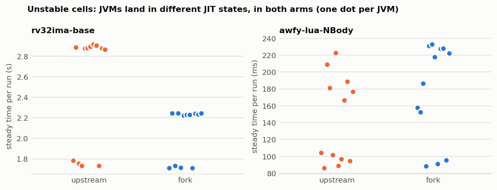

# Fork against upstream on 31 workload cells (local)

Run: 2026-10-18 21:45 to 2026-10-19 00:22 local time. This was a single session on a laptop, so treat
the numbers as exploratory timing evidence, not fixed-runner thesis evidence.
It extends [branch-condition-fusion-benchmarks.md](branch-condition-fusion-benchmarks.md), which
compared only the fusion PR branch on three workloads. Here the arm is the **whole fork**, and the
workload set is taken from the thesis repository (`gitlab/experimental`, `c804f164b`).
Raw data and scripts: [data/workload-ab-2026-10-18/](data/workload-ab-2026-10-18/).

| arm | Endive revision | compiler jar sha256 |
| --- | --- | --- |
| **up** | `bytecodealliance/endive` main `1580f534` (still upstream main on 2026-10-18) | `6101f7741503…` |
| **fork** | `fuse-branch-conditions` `44f68a6f` (engine code = `7e743d80`) | `9dfba22650ea…` |

Each arm was built in its own worktree with
`./mvnw package -Dquickly -Dspotless.skip=true -pl compiler,wasi -am` against the fork's own
Maven repository. Neither arm was installed anywhere. Each runs from its own `target/*.jar` files
plus ASM 9.10.1. The fork's compiler jar is the one the thesis report
`FORK1_FORK_ORACLE_AND_MODEL.md` records for `7e743d80`.

## Summary

- **The fork is faster in 21 of 31 cells by steady state** (paired 95 % CI excludes 0; 20 if the
  bimodal rv32ima cell is set aside), typically **−5 to −11 %**, and −21 % on the float kernel
  `fkernel`. Nine cells are not significant; six of them have a median below zero.
- **One significant regression: `rustvm-base`, +12.6 %** [+9.9, +14.8]. Bisection puts it on
  `82f39301` (compact `br_table` encoding). With `tableswitch` forced, the regression disappears
  (see [Regression](#regression-rustvm-base-and-lookupswitch)).
- **Guest output is identical** across both arms and all 24 samples of every cell, with
  timing numbers masked.
- **Runtime compilation is 2–5 % slower** in most cells, about 10–90 ms; 17 of 31 cells are
  significant. This is the cold-JVM cost described in
  [compile-time-regression.md](compile-time-regression.md). The incremental passes reduced it
  but did not remove it.
- The three workloads of the earlier PR-only run reproduce, and the full fork goes slightly further:
  Lua split −7.6 % (PR: −4.1 %), SQLite split −10.4 % (−9.5 %), QuickJS split −7.5 % (−6.4 %),
  Lua base −4.7 % (−5.5 %).


## Setup

**Machine:** AMD Ryzen 7 7840HS, Linux 7.2.10, OpenJDK 21.0.12.1 (`/usr/bin/java`), `ondemand`
governor with boost on (no root to change it). The desktop session was running (Firefox, Baloo).
Every measurement JVM was pinned with `taskset -c 4-7`.

**Protocol:** as in the fusion benchmarks. Each sample is a fresh JVM running the thesis
`EndiveRun.java` (WASI on `MachineFactoryCompiler`): parse, runtime compile, then
`warmup` + `reps` runs of `_start`. Both arms run in a seeded random order within each round
(`BENCH_ORDER=permuted`, seed `20261018`), with **12 rounds per cell**. The verdict is the
median of the paired per-round ratios fork/up, with a bootstrap 95 % CI (10,000 resamples).
Metrics: `exec_ms_median` (steady), `first_exec_ms`, and `compile_ms` (parse + runtime compile).
`campaign.sh` holds the full workload table: module, warmup/reps and guest arguments.

**Modules.** Both arms run identical bytes (`campaign_modules.sha256`). This compares engines,
not split against unsplit.

| group | cells | source of the module |
| --- | --- | --- |
| earlier anchors | lua base/split, sqlite split, quickjs split, python split | thesis `results/2026-10-17/fork-fusion-ab/splits` (pinned) and the tracked corpus |
| emulators | binjgb, i8080, z80, genesis (base and 8 kB split) | tracked corpus; splits made with `run_corpus_split_matrix.sh prepare` (canonical endive-throughput recipe: 3-run Node edge profile, `jvm` metric, 8 kB, post-cleanup, `br_table` grouping). Gates: G1 output identical to pristine, G2 over-8 kB methods 3→1 / 1→0 / 2→1 / 8→3 (`split-prepare.log`) |
| synthetic Rust | rustvm, fkernel (base and the tracked `*_pgo.wasm` split) | tracked corpus |
| negative control | rv32ima base (hot function ~5 kB, under every wall) | tracked corpus |
| SQLite apps | `sqlite_app --mode inmem`, `speedtest1 --memdb --size 5 --testset mix1` | blanket split 8-64 with `br_table` grouping, no profile (the unsplit modules run `sqlite3_step` > 64 KB in Endive's interpreter: 33 s and 39 s per run, where fusion cannot act) |
| AWFY Lua | Richards, DeltaBlue, Json, NBody, CD on `lua_awfy_wasi.wasm` | blanket split 8-64-bt (as `run_awfy_lua_startup.sh`), AWFY sources mounted at `/awfy` |
| AWFY JS | Richards, DeltaBlue, Json, NBody, Bounce, CD on `qjs_awfy_wasi.wasm` | blanket split 8-64-bt |

The split modules were sized by the thesis `wasm-opt` against the *vendored* Endive's costs.

## Results

Steady state is the median of the in-process repetitions. The tables for first execution and
compile time are in [data/workload-ab-2026-10-18/results/SUMMARY.md](data/workload-ab-2026-10-18/results/SUMMARY.md).

| workload | n | up ms | fork ms | Δ steady | 95 % CI | Δ first exec | Δ compile |
| --- | ---: | ---: | ---: | ---: | --- | ---: | ---: |
| lua-base | 12 | 1,787 | 1,702 | **−4.7 %** | [−5.9, −3.4] | −5.2 % | +4.1 % |
| lua-split | 12 | 265 | 241 | **−7.6 %** | [−11.7, −4.3] | −9.7 % n.s. | +3.4 % |
| sqlite-split | 12 | 1,906 | 1,720 | **−10.4 %** | [−11.0, −8.0] | −8.7 % | +3.3 % |
| quickjs-split | 12 | 8,615 | 7,974 | **−7.5 %** | [−8.8, −7.0] | −7.5 % | +2.9 % n.s. |
| python-split | 12 | 381 | 364 | −6.1 % | [−12.3, +2.2] | −5.6 % | +4.7 % |
| binjgb-base | 12 | 4,465 | 4,175 | **−6.5 %** | [−7.2, −5.6] | −7.2 % | −0.1 % n.s. |
| binjgb-split | 12 | 4,123 | 3,764 | **−8.6 %** | [−9.7, −7.5] | −8.3 % | +3.5 % |
| i8080-base | 12 | 15,584 | 14,544 | **−6.4 %** | [−7.8, −3.7] | −5.9 % | +1.3 % n.s. |
| i8080-split | 12 | 2,261 | 2,081 | **−9.0 %** | [−14.0, −3.0] | −5.1 % | +2.8 % n.s. |
| z80-base | 12 | 11,120 | 11,107 | +1.0 % | [−1.1, +1.7] | +1.0 % n.s. | +2.1 % n.s. |
| z80-split | 12 | 2,760 | 2,646 | **−4.7 %** | [−5.2, −3.4] | −1.2 % n.s. | +3.7 % |
| genesis-base | 12 | 2,573 | 2,387 | **−7.3 %** | [−8.1, −6.2] | −6.7 % | +4.3 % n.s. |
| genesis-split | 12 | 940 | 809 | **−6.1 %** | [−15.3, −2.6] | −8.4 % | +0.4 % n.s. |
| rustvm-base | 12 | 6,391 | 7,236 | **+12.6 %** | [+9.9, +14.8] | +13.9 % | +1.9 % n.s. |
| rustvm-split | 12 | 892 | 882 | −2.2 % | [−4.2, +1.0] | −1.1 % n.s. | +2.4 % n.s. |
| fkernel-base | 12 | 4,533 | 3,548 | **−22.0 %** | [−24.9, −20.5] | −21.8 % | +3.4 % |
| fkernel-split | 12 | 382 | 301 | **−21.2 %** | [−22.3, −19.0] | −20.3 % | +2.9 % n.s. |
| rv32ima-base | 12 | 2,877 | 2,229 | **−22.3 %** (bimodal, see below) | [−23.3, −2.7] | +0.5 % n.s. | +1.9 % n.s. |
| sqlite-app-split | 12 | 1,917 | 1,866 | −4.1 % | [−7.5, +1.0] | −3.7 % | +3.8 % |
| speedtest1-split | 12 | 2,533 | 2,309 | **−8.3 %** | [−10.1, −7.0] | −11.1 % | +3.5 % |
| awfy-lua-Richards | 12 | 2,149 | 1,925 | **−11.2 %** | [−16.3, −6.4] | −7.7 % | +3.5 % n.s. |
| awfy-lua-DeltaBlue | 12 | 201 | 202 | −4.3 % | [−7.2, +3.2] | −4.6 % | +2.6 % n.s. |
| awfy-lua-Json | 12 | 928 | 926 | −5.9 % | [−8.7, +5.0] | −4.6 % n.s. | +3.2 % |
| awfy-lua-NBody | 12 | 135 | 202 | +23.5 % (bimodal, see below) | [−2.4, +64.1] | −5.2 % n.s. | +3.6 % |
| awfy-lua-CD | 12 | 11,072 | 10,396 | **−6.1 %** | [−8.5, −4.8] | −4.6 % | +5.9 % |
| awfy-js-Richards | 12 | 2,767 | 2,603 | **−6.4 %** | [−7.1, −5.2] | −11.3 % | +3.7 % |
| awfy-js-DeltaBlue | 12 | 268 | 229 | **−16.6 %** | [−22.3, −9.0] | −7.9 % | +3.8 % |
| awfy-js-Json | 12 | 968 | 909 | **−6.7 %** | [−8.2, −3.8] | −8.2 % | +2.8 % |
| awfy-js-NBody | 12 | 177 | 182 | −0.0 % | [−7.3, +9.8] | −10.2 % | +1.0 % |
| awfy-js-Bounce | 12 | 395 | 350 | −14.2 % | [−18.7, +2.3] | +3.0 % n.s. | +2.6 % |
| awfy-js-CD | 12 | 790 | 747 | **−7.7 %** | [−10.3, −3.4] | −10.1 % | +2.3 % n.s. |

Bold: the CI excludes 0. "n.s." in the first-exec and compile columns marks a CI that includes 0;
the other entries in those columns are significant.


The second figure shows the order of effects: splitting moves the time by up to 7× (i8080,
z80, rustvm, fkernel), and the fork adds a smaller step on top. rustvm unsplit is the one row where
the fork's dot sits right of upstream's.



**Bimodal cells.** `rv32ima-base` and `awfy-lua-NBody` switch between two JIT states from JVM to
JVM in **both** arms. rv32ima runs either about 1.73 s (both arms) or 2.88 s upstream against
2.23 s on the fork. NBody runs either about 90 ms or about 200 ms, and the share of slow JVMs
differs between the arms by chance. A per-round ratio then compares states, not engines, so read
both cells as undetermined. rv32ima's first-execution metric is neutral (+0.5 %).

## Interpretation

1. **The gain is broad, not specific to a few workloads.** Emulators, interpreters (Lua, QuickJS,
   CPython), SQLite applications, AWFY under two guest interpreters, and synthetic Rust all
   improve by roughly the 4–10 % that the fusion PR showed on three workloads. Most of these
   cells run compiled bytecode with comparison-heavy hot loops. There, fused branches and inline
   trivial helpers remove `invokestatic` calls that C2 does not always inline (see
   [inlining-at-8000-bytes.md](inlining-at-8000-bytes.md)).
2. **Interpreted base modules also improve** when their hot method is over HotSpot's 8000-byte
   `HugeMethodLimit` but under 64 KB: i8080-base −6.4 %, binjgb-base −6.5 %, genesis-base −7.3 %,
   fkernel-base −22 %. Such a method runs in HotSpot's bytecode interpreter, where every removed
   helper call is a real saved call. z80-base is the exception (±0).
3. **fkernel (−21 to −22 %) is the largest effect.** Its hot loop is a float reduction, so the
   saved `f64` comparison helpers and the inline trivial helpers dominate.
4. **Splitting and the fork compose.** Every split cell where the fork's effect is significant
   improves on top of the split. Examples: speedtest1 is 10× faster when split (39 s → 2.5 s
   smoke), and the fork then saves another 8 %; i8080 split −9 %; SQLite split −10 %.
5. **Compile time** is 2–5 % slower (10–90 ms; CPython +270 ms on a 5.8 s compile). This is paid
   once per instantiation. It is smaller than the execution gain in every cell with a significant
   gain; it is a net loss only in `rustvm-base` (regression below) and in short cells such as
   `rustvm-split`, whose execution change is not significant.

## Regression: rustvm-base and `lookupswitch`

`rustvm`'s hot callee `exec_op` is a `br_table` over op codes 0–159. Only 0–9 and 100–159
have arms; the 90 codes between go to the default. The function is 16.6 kB of JVM bytecode,
over `HugeMethodLimit`, so HotSpot interprets it.

For this table, `SwitchEmitter` (from `82f39301`) prefers `lookupswitch`, because 70 key/label
pairs (568 bytes) are smaller than a 160-entry `tableswitch` (652 bytes). HotSpot's interpreter
executes a `lookupswitch` this size as a binary search, about seven compares per dispatch,
instead of one bounds check and an indexed jump. On a dispatch-bound loop that costs 12–14 %.

Bisection (`bisect-rustvm.txt`, three alternating fresh-JVM samples per commit against upstream):

| commit | rustvm-base vs upstream |
| --- | --- |
| `f5225324` fusion | ≈ 0 |
| `b4d973e1` ABI repair | ≈ 0 |
| `3ba75b28` PR branch (fusion + extensions, no switch change) | ≈ 0 |
| `82f39301` compact `br_table` encoding | **+13 %** |
| `5a02a7dd`, `44f68a6f` | +13 % |
| `44f68a6f` with `-Dendive.compiler.unsignedCompareFusion=false` | +13 % |
| `44f68a6f` with `SwitchEmitter` forced to `tableswitch` (local experiment, not committed) | ≈ 0 |


z80-base is also an interpreted dispatcher over 8000 bytes, and the forced-`tableswitch` build
does not change it.

The size-first rule trades dispatch speed for bytes even where the bytes do not matter. A
`tableswitch` costs at most `12 + 4·n` bytes, and here the saving is 84 bytes of a 16.6 kB
method. Possible fixes, to be measured before choosing one:

- prefer `tableswitch` unless the byte saving moves the method across a real limit (8000 bytes,
  64 KB), or unless the table is very sparse (for example density < 25 %, like `javac`'s
  heuristic);
- or let the 8-64 KB size model price the switch, and choose `lookupswitch` only when it
  avoids a wall.

`perf/switch-encoding` (the upstream candidate for this change) is affected in the same way.
Do not open it as an upstream PR before this is resolved.

## Limitations

- One laptop, one session, `ondemand` with boost, desktop running. Paired interleaving cancels
  drift, not all noise; repeat on kent-yuria before citing anything in the thesis.
- 12 rounds per cell; the bisection uses 3 samples per commit (enough for a 13 % step, not for
  small effects).
- JDK 21 only; the fork's unsigned `i32` fusion is on there (`MachineFactoryCompiler`, Java 18+).
- Runtime compiler only (`MachineFactoryCompiler`); build-time compilation not measured.
- The AWFY and SQLite-app splits are blanket (no profile) splits. Their quality does not matter
  for an engine A/B, but they are not the thesis' product recipe.
- Not covered: Havlak (144 s per Lua run), unsplit CPython/QuickJS/SQLite (interpreter-bound
  by Endive's own interpreter, shown neutral in the earlier run), JDK 17.

## Reproduce

```sh
B=<bench dir>
git worktree add --detach $B/wt-up 1580f534; git worktree add --detach $B/wt-fork 44f68a6f
for x in up fork; do (cd $B/wt-$x && ./mvnw -q -Dmaven.repo.local=$HOME/.m2/repository-endive-fork \
  -Dquickly -Dspotless.skip=true package -pl compiler,wasi -am); done
# cp-<arm>.txt: wasm, runtime, log, wasi, compiler, annotations/annotations target jars + ASM 9.10.1
# classes-<arm>: javac --release 17 -cp "$(cat cp-<arm>.txt)" -d classes-<arm> EndiveRun.java
cd <thesis repo>/endive-benchmark/wasi_exec
SPLIT_LIMITS=8 OUT_DIR=$B/splits ./run_corpus_split_matrix.sh prepare binjgb i8080 z80 genesis
# blanket 8-64-bt splits of lua_awfy, qjs_awfy, sqlite_app, speedtest1: see "SQLite apps"/"AWFY" rows
$B/campaign.sh 12 && python3 $B/summarize.py > $B/results/SUMMARY.md
$B/bisect_arm.sh <commit>
python3 compiler/docs/data/workload-ab-2026-10-18/plot.py   # figures
```
